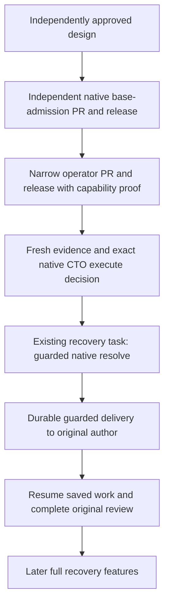

# Independent bootstrap for an output-bearing reconciliation hold

Status: design for independent review. [Issue #70](https://github.com/phenix3443/paperclip/issues/70).
Date: 2026-10-27. This document grants no implementation, deployment or recovery authority.

## Decision proposed for review

There is no supported agent-operated bootstrap path under the deployed contract.
Keep the real hold and the original recovery task. The recommendation is a separate,
reviewed native base-admission release and a narrow operator release, developed on
new infrastructure tasks that are not held. They must not depend on the held
[#60](https://github.com/phenix3443/paperclip/issues/60) work or its unfinished
[PR #63](https://github.com/phenix3443/paperclip/pull/63).

This explicitly revises only the bootstrap choice in the accepted
[#59 design](2026-10-27-native-execution-reconciliation-admission.md#bootstrap-the-implementation-tasks-own-hold):
a real user message remains supported, but is not the chosen route for this incident.
An independently released, Board-authenticated operator may submit an exact,
CTO-authorized reconciliation through native admission. An agent cannot submit it,
become a user, or call the old user-only continuation helper. This proposal does not
change that helper's actor check. Design approval alone grants neither credentials
nor a live execution decision. CTO must separately commission implementation and
ops release, then authorize one immutable execution payload in the original recovery
task. If any prerequisite is unavailable, remain blocked and report that gap.

## Evidence and limits

| Source | Exact version inspected | Result |
| --- | --- | --- |
| This checkout | `cd34e2a0be2e3443da74d2f8a54d36a352bc1e7e` on `docs/output-hold-bootstrap-plan`, from `origin/develop` | Isolated documentation workspace; no #63 implementation incorporated |
| Accepted #59 | Approved document head `0b1d173df811459fd210861b2387cd49f238cb9e`; [PR #62](https://github.com/phenix3443/paperclip/pull/62) merge `17a63c1ae53fb204c84da2584ff601bd64ef9c97` | Seven native prerequisites, base admission A and separate review-state B; bootstrap A requires a real user |
| Approved operator contract | [ai-team document](https://github.com/phenix3443/ai-team/blob/001a97718166f191e295185e5dcf80f3e9843bcf/docs/paperclip/lease-output-recovery-contract.md), merge `001a97718166f191e295185e5dcf80f3e9843bcf`, approved head `7046387e223eafc37422f77554ef0f6689710f3d` | Board-only native recovery, exact versioned CTO decision, no unknown effects, seven prerequisites |
| Current deployed server | Authenticated `GET /api/health`: commit `fdbafff72d8fd6ae7f12eb5827631efc67d208f3`; `~/.paperclip/cli/current` -> `installs/git/fdbafff72d8f`, matching installed build-info | `nativeRecovery: {}` is not proof of admission capability. Installed JS must be inspected; no recovery request was sent |
| Operator source | ai-team checkout `aa5d50a1185d8ac7d2ca5e80afdd3708eaaa9418`, `scripts/paperclip/operator_requests.py`, `docs/paperclip/internal-recovery.md` | Existing `restore_execution_recovery` is for proven no-output execution only |
| Incident diagnosis | Recovery task document `diagnosis`, revision `10a200c9-d233-44dc-b7f8-0ee5494a483a`, collected 15:37–15:44Z | Historical stopped PID/group evidence and saved output; not a fresh lease check or full external-effects audit. Exact issue/run/action tuple stays in that document, outside Git |
| Saved implementation | PR #63 head `b47b2f086597f1315991a33e7f8cca0a125988e8` | Saved output, not an approved releasable implementation. Diagnosis records failed/pending verification; no replay or re-authoring |

The diagnosis inspected deployment `6d74176932f9a9970a109fe98b26b803fe55b4f5`.
It cannot certify the later deployment above. Neither historical health nor a
process absence snapshot proves current eligibility. This plan uses the diagnosis
for the incident's facts and separately inspects the current native implementation.
All future execution must refresh process, lease, source-state and artifact evidence.
No runtime candidate IDs, secrets, evidence bodies or executable production payloads
are stored in this repository.

## Supported options and the dependency cycle

| Option | Existing support | Why it does or does not unblock this incident |
| --- | --- | --- |
| Fresh real user message | `admitExplicitNativeContinuation` verifies `actorType=user`, a real user comment and no agent run attribution | Supported by #59. Requires a real user action. This assignment says Board need not operate internal APIs; no such action or exception was supplied. Agent comments and `onBehalfOfUserId` cannot substitute |
| Existing operator no-output restore | Fixed `restore_execution_recovery` whitelist | Refuses output, PID/session/log evidence and inappropriate task state. This incident has saved commits and logs. `not_performed` would be false |
| Ordinary agent wake, retry or task recreation | Normal execution gates retain reconciliation hold | Not bootstrap authority. Can create hold-cancelled admissions, not settle the output. Recreating the business task loses provenance and is forbidden |
| Direct old Board-only resolve | Native route exists | Board authentication alone does not prove versioned authorization, transactional gates or payload idempotency. No approved output-bearing operator action exists. Do not expose a generic proxy or use this route as a shortcut |
| Wait for #60 or the later full operator | Not delivered | Circular: the code needed to recover is held by the run needing recovery |
| Independent base-admission plus narrow operator (recommended) | Proposed, not installed | Work starts from a released source base in unheld infrastructure tasks. Ships all required safeguards before it can touch the original action. Does not consume #63 or require #60 to finish |
| Keep hold | Supported | Safe fallback if CTO declines the separate release or evidence remains unknown. Report missing capability; no claim of recovery |

The first two new tasks build infrastructure; they do not replace the held business
task, change its author/reviewer, approve #63, or clear its history. If either new
infrastructure run itself becomes held, stop that delivery and report to CTO; do
not recursively invent another bypass. Implementation/release authorization and
live recovery authorization are distinct gates.

## Native module and seven required guarantees

The owning module is native execution reconciliation. Its public interface remains
`POST /api/issues/:id/recovery-actions/resolve` with the strict `admission` object
specified by #59. The operator is an adapter to that interface. It owns artifact
and host evidence gathering, not native authorization, transactions or dispatch.
The delivery seam is the guard inside the existing queue transaction, not a host
scheduler or a second wake call.

| # | Gap in native implementation | Required independent base delivery |
| --- | --- | --- |
| 1 | Strict resolve schema accepts run/outcome/evidence but no complete expected snapshot | #59 `admission.expected`, canonical expected digest, company/project/tuple, owner/responsible user, finished run, status/version, workspace binding, policy/state, unblock and monitor binding |
| 2 | Board check verifies caller, not an immutable CTO execution decision | Native append-only document decisions with authenticated actor/run attribution; immutable canonical payload, exact revision/digest/latest revision, scope, expiry, revocation and company authority verification |
| 3 | Source/action locks do not serialize every run, wake, coordinator and lease condition | One tx-aware admission module checks all membership predicates, all newer statuses and direct/context successors after locks; no host precheck substitutes |
| 4 | Hand-back helpers and delayed delivery read mutable gates outside the final write transaction | Gate writers participate in a documented common lock protocol; guard revalidates in native enqueue and claim before provider start |
| 5 | Pending-state exception does not establish safety for other states | Base release refuses **every** non-null `executionState`; subsequent B support is separately reviewed |
| 6 | Existing action wake key is not payload-level request idempotency | Native receipt with unique key/digest and unique committed action; durable unique successor and fenced response-loss settlement |
| 7 | Reopen/settle paths and separate delivery can mutate before every check is proved | Action/evidence/status/receipt commit together; any refusal rolls back action, continuation, wake and run; refusal audit is separate |

These are acceptance obligations, not claims that a wrapper can repair native gaps.
The native implementation appendix below supplies exact source anchors. No reduced
"bootstrap-only" transaction guarantee is permitted because the target happens to
be one tuple.

## Request, evidence and authorization contracts

Reuse #59's strict `execution_reconciliation_admission_v1` schema and canonicalization:
UTF-8 JSON, keys sorted by Unicode code point, no whitespace, explicit schema-defined
nulls, safe integers only, UTC millisecond timestamps. Reject unknown/duplicate keys,
missing required keys, unsafe/nonfinite numbers and unpaired Unicode surrogates.
Normalize schema-trimmed strings before digesting. Shared test vectors must agree
between native TypeScript and operator Python; do not require the operator to import
TypeScript at runtime.

`admission` contains `schema`, `idempotencyKey`, `expected`, `expectedDigest`, and
`authorization {documentId, revisionId, revisionNumber, bodyDigest, decisionId}`.
The server constructs expected state from locked native rows. In addition to the
#59 fields, bind the selected execution workspace ID and its pending selection,
all persisted monitor control fields, source run result/release evidence digest,
and original action evidence digest. Missing columns cannot silently become null.
The required fixed expected projection has no optional keys:

- Scope: `companyId`, `projectId`, `issueId`, `runId`, `actionId`.
- Run: `status`, `finishedAt`, `agentId`, `processPid`, `processGroupId`,
  `runtimeMode`, canonical `resultJson` digest (including release proof).
- Action: `status`, `cause`, `kind`, `outcome`, `ownerAgentId`,
  `returnOwnerAgentId`, `updatedAt`, canonical original `evidence` digest.
- Issue: `status`, `statusVersion`, `assigneeAgentId`, `assigneeUserId`,
  `responsibleUserId`, `checkoutRunId`, `executionRunId`,
  `executionWorkspaceId`, `workspaceBindingRevision`, `workspacePendingSelection`,
  complete `executionPolicy`, complete `executionState`, `unblockDescriptor`.
- Monitor: `monitorNextCheckAt`, `monitorWakeRequestedAt`, `monitorLastTriggeredAt`,
  `monitorAttemptCount`, `monitorNotes`, `monitorScheduledBy`, including nulls.
- `unstartedRunIds`: sorted exact IDs of the sole allowed unused-admission exception.

Gate relationships are re-read under their parent locks rather than trusted from
this projection. Migration/API/shared types/UI client/docs stay synchronized.
`sourceIssueStatus` is an authorized **target**, not CAS.

Evidence payload P precedes its digest, which precedes immutable revision R, which
precedes native decision D, which precedes the request digest. No object hashes
its future decision or its own digest. P fixes schema, scope `execute`, company,
source tuple, expected digest, expiry, exact resolve intent and evidence. Intent
includes outcome, target, full outcomeEvidence, resolution note and repair evidence.
Request digest covers the whole validated request except its idempotency key;
changing the decision/revision makes a different request. No Markdown parsing or
free-text approval heuristic is part of authorization.

Use the #59 additive `issue_document_decisions` and
`execution_reconciliation_receipts` schema. The actual decision actor must be the
CTO agent ID on the Board-managed company authority list, authenticated by native
agent context. A role/name, requester-submitted actor ID, comment, task `done`, or
an inherited human identity is insufficient. Re-read the latest document pointer,
decision target/body digest/scope/expiry/revocation and current authority under lock.
An R2 revision invalidates an unused approval of R. Maximum decision lifetime is
72 hours, with the payload expiry no later than decision expiry. Design/release
approval cannot satisfy `scope=execute`.

The authority list defaults empty. Configuration is a real release prerequisite:
the existing deployed whitelist cannot set it. A separately reviewed operator
extension may provide one fixed, company-scoped configuration action bound to the
reviewed release manifest and exact CTO identity; no arbitrary company PATCH body.
Ops release verifies the result through native readback before enabling recovery.
This configuration action is part of the independently authorized operator work,
not something the Coder executes now. If it is not approved/deployed, refuse with
`authority_not_configured`; do not fall back to a display role or user impersonation.

Every effect in P is `completed` or proven `not_performed`, with object revision,
content digest, read time and coverage. Unknown effects are explicit entries with a
resolution owner and **block execution**. Saved commits plus remaining verification
can be `mixed`; unknown is never `mixed` or `not_performed`. Freeze external artifacts
operationally during evidence/execution or refuse if their mutability cannot be
bounded. GitHub/filesystem reads cannot join a PostgreSQL transaction. Native digest
binding proves the evidence used, not that the external world has remained unchanged.
Post-request operator readback and the successor must verify saved head/files before
any further business action. Never rerun saved tool calls.

## Transaction, gate writers and durable delivery

Use #59's complete L0–L11 protocol, with READ COMMITTED reads after acquisition:
key advisory lock; company; owner agent; shared company tree-hold advisory lock;
source issue; blocker issues in ID order; actions; wakes; coordinator; source/member
runs; leases; authorization document. Lock action/run/lease sets in ID order.
Where project pause is company-accounting-serialized, use that same serialization;
otherwise explicitly lock the project before source issue and update its writers.
No raw-db helper inside a tx callback counts as a transactional read.

Audit every closing writer: dependency add/reopen, pending interaction/approval,
subtree/project/company/agent pause, budget hard-stop, monitor changes, workspace
binding/pending selection, policy/state/owner changes, authority/revocation/revision,
wake enqueue/claim/defer, retry/new run and coordinator/lease writes. They must take
the same preceding locks as admission. In particular: subtree hold takes the exclusive
tree lock; approval creation/reopening/linking locks affected issues in ID order;
policy transitions recompute from the locked issue; decision/revoke insertion locks
the document; authority edits serialize on company. An absent monitor/dependency/
wake row needs its parent issue lock to prevent phantoms. An existing row lock alone
cannot prevent insertion. Lease acquisition and context-only successor insertion
must also acquire the source issue gate before insertion, not just their own row.

Reject all live/queued/scheduled retries, deferred/claimed wakes, active recovery,
held coordinator ownership or unreleased provider/environment leases. Use #59's
full run-membership and newer-run predicate, including terminal newer runs and
context/retry links across filing issues in the same company. Unknown or absent
finish time refuses. Only exact expected IDs of proven hold-cancelled, never-started
admissions qualify for #59's unused-admission exception. Do not classify a run with
PID/session/output as unused. Stop proof includes PID/PGID startup identity and host,
provider receipt, and native lease/coordinator release. A historical `ESRCH` or
`providerStopped:true` alone is insufficient. Evidence must fence against a new
process or lease before dispatch.

Deadlock/serialization failures roll back fully and return `409 concurrent_change`.
No blind automatic transaction retry can reuse stale evidence. Refusal audit may
persist separately; source action, execution history and review decisions do not.
On success the receipt, exact evidence/references, action resolution, target status
and durable pending delivery commit together. No external process starts in this tx.

The worker's unlocked due-row selection is only a hint. It hands action/receipt IDs
to an internal guarded enqueue. Revalidate owner, whole policy/state, authorized
workspace, all gates, process/lease release, latest authorization/authority/revocation
and successor absence **inside enqueue's transaction**. Revalidation must use the
receipt's post-admission status/version and action evidence, not compare those with
the intentionally superseded pre-admission snapshot. The worker holds no outer
transaction while calling enqueue. Insert wake, run, `retryOfRunId` and delivery
receipt in one commit with unique native constraints. Use the existing action wake
key. Concurrent workers cannot create two successors.

Unlike the known residual described in #59, this bootstrap release must also fence
**queued-run claim before provider start** against closing gates and revoked/expired
authorization. Queue acceptance alone is not sufficient. The bootstrap-tagged run
claim joins the same gate protocol and checks its receipt; generic runs keep their
existing behavior. A closed temporary gate leaves durable `waiting:<gate>` evidence;
changed identity/state/revision, revoked authority or a conflicting successor leaves
`invalidated:<reason>` with no provider start. A committed receipt remains immutable;
revocation does not erase it but prevents unstarted delivery. Existing due delivery
processing uses bounded backoff/deadlines and records valid waits; no new scheduler
or host polling loop is introduced. A deadline leaves an inspectable stopped path
for the original recovery owner, not an endless pending label.

## Receipt, retry and lost response

Retain #59's company-unique key and unique committed action receipt, with expected
snapshot/digest, request digest, authorization revision/decision/body digest, actor,
result and continuation handle. Board-only readback is exposed through the narrow
operator action, not to agents. A matching committed receipt is returned on identical
reentry. Same key/different digest or same action/different intent is conflict.

After transport loss, preserve exact key and request and read the receipt. Missing
or `unsettled` is unknown, not proof of rollback. The native `settle` operation takes
the same key lock: it returns the committed receipt or atomically creates an
`abandoned` tombstone after any in-flight holder finishes. A late POST using that
key cannot commit past the tombstone. Use a bounded database lock timeout; if settle
times out, remain uncertain and stop. A new key requires a proven abandoned old key,
fresh evidence and a new exact decision. The operator permits at most one identical
retry per operation, with all refusals preserved; no unbounded recovery loop.

A receipt proves admission, not business recovery. Acceptance separately reads the
source owner/state/history, delivery state, sole successor, its actual run binding,
process/useful output or a valid wait. `resolved`, hold disappearance and `queued`
alone are not success evidence. Committed effects cannot be undone by changing old
rows. Any later fault uses existing native stop/recovery with a new audit record.

## Bounded operator interface and refusal matrix

A future fixed `bootstrap_output_reconciliation` action accepts only the immutable
authorization reference and reason. The released manifest and approved payload must
agree on company/source tuple and permitted target. No candidate discovery, arbitrary
URL/method/body, extra wake, owner change, credential export or host SQL is allowed.
The operator alone retains its existing Board credential. The request adapter can
call only native capability/read/resolve/receipt/settle operations for that tuple.
Existing no-output actions retain their semantics and tests.

| Threat or changed fact | Required result |
| --- | --- |
| Ordinary agent, forged user comment, wrong company/CTO/tuple, stale owner/responsible user | 401/403 or exact identity refusal; zero recovery effects |
| Unsupported capability/schema, wrong installed revision, empty authority list | Refuse before live POST; never drop admission fields or use old resolve |
| New evidence revision, changed expected digest/workspace/head/policy/state/monitor | Stale/conflict refusal; fresh evidence and decision required |
| Unknown effect, unreadable artifact, missing coverage or stop receipt | Stop with owner for missing evidence; retain hold |
| Live/reused PID/group, provider session, active lease/coordinator, new run/wake | Native atomic refusal; no clear/kill/replay workaround |
| Dependency, pending human question/approval, pause, budget or active monitor | Refuse admission or durable guarded wait after commit; cannot remove business gates |
| Any non-null state in base A; pending/escalated/human/limit review in B | Refuse; default/null maximum is 3; keep real responsible user and all decisions |
| Duplicate/concurrent requests or workers | Same receipt or conflict; at most one action result, wake and successor |
| Lost response, receipt read failure or settle timeout | Uncertain; no different payload/key or extra wake until native settlement proves outcome |
| Revocation/expiry/gate closes after enqueue but before claim | Guard prevents provider start; preserve receipt and valid wait/invalidation |

## Independent delivery and review-state slice

CTO must commission these sequential deliveries after design approval/merge; this
plan does not create them or repoint existing business assignments:

1. **Native base A, independent of #60/#63.** Deliver full admission, authority
   decisions, receipts/settle, writer serialization, guarded enqueue and claim.
   Refuse every non-null executionState. Implement from a verified released source
   base in an unheld infrastructure task; the source must not import unfinished
   #63 as an approved dependency. Preserve #63's authorship/history/artifacts. Later
   #60 integration can adopt the released module after its own review, not duplicate
   it. Native schema/types/routes/services/UI client/migrations/docs move together.
2. **Minimal operator adapter and scoped authority configuration.** Separate ai-team
   Issue/PR, independent cross-type review, exact approved release, native capability
   proof, fixed configuration/target manifest and explicit ops authorization. Does
   not depend on the later full operator action it is intended to unblock.
3. **Original recovery operation.** Ops refreshes evidence and obtains the native
   CTO execute decision in the existing recovery task. Unknown effects or leases
   still block it. Existing independent recovery acceptance remains required. The
   original author resumes saved work; final verification/review of #63 is still due.
4. **Separate native B.** Only after A, review eligible `changes_requested`: original
   author equals returnAssignee/owner, last native decision is changes_requested in
   the unchanged policy, no human takeover, count below effective limit (default 3).
   Target `in_progress` only; preserve canonical whole state/policy and every native
   decision/counter before admission, after commit, delivery and subsequent review.
   Pending/escalated/approval/at-limit states remain refused. No `todo` phase reset.
   This B release is not a bootstrap dependency for the diagnosed state-null run.

If A is too broad for one safe PR, split its modules into a reviewed PR stack whose
capability stays disabled until **all** guards and tests land. A partially delivered
slice must remain unusable for output recovery. CTO owns assignment and sequencing;
this design does not silently transfer #60's author or reviewer.

## Isolation, release and rollback acceptance

Future implementation uses disposable real PostgreSQL and synthetic companies,
runs, actions, documents and leases. Tests cross native routes, services, delivery
and provider-start claim. Fake operator tests supplement, not replace, native
transactions. No production resolve or real hold probe is an acceptable test.

| Validation | Observable requirement |
| --- | --- |
| State/evidence/authority R -> R2, wrong actor/scope/digest, expired/revoked approval | Both commit orders against admission and worker claim; stale actor/revision never starts a provider |
| Dependency/approval/question/pause/budget/monitor/workspace/owner/policy updates | Both commit orders at resolve, enqueue and claim; refusal rollback or valid wait, preserved business gate |
| New terminal run, context-only successor, live/reused PID, lease/coordinator acquisition | Both insertion/commit orders, exact native refusal; missing finish/stop evidence refuses |
| Identical/conflicting concurrent keys and distinct keys for one action | One receipt/result/successor maximum; conflicts observable, no hidden reopen |
| Commit then drop response; delay before L0/commit while settle runs; settle timeout | Matching receipt or fenced abandoned key; late request cannot pass tombstone; uncertain remains stopped |
| Crash after admission, after queue commit and before worker acknowledgement; two workers | Durable reentry, no second wake/run; successor links fixed in queue commit |
| Unknown effects, unreadable/mutated artifacts, evidence overflow | No recovery POST or no native writes; no truncation and no false not_performed |
| A with any non-null state; B author/refusal/limit cases | Whole policy/state/history unchanged; default/null max=3, real responsible user; later done still enters original independent review |
| Migration and old clients/server; disabled feature; old operator actions | Legacy allowed behavior remains tested; absent capability fails closed; no weakened output fallback |

Capabilities are server-derived and name schema version, base A, bootstrap guarded
claim and optional B, tied to exact build and migration level. `health` commit alone
or `nativeRecovery:{}` is insufficient. Ops must read the reviewed flags and installed
build, run isolated acceptance, and verify the narrow operator matches them. No
capability is declared from the presence of source files or queued labels.

Use additive #59 tables/column/index migration only; no real run/action/decision
rewrites. Duplicate legacy wake keys cause explicit migration refusal, not deletion.
Include index/receipt retention, legacy-row refusal and downgrade tests. Rollback
first disables new admission/operator actions, fences undelivered bootstrap requests
and retains committed receipts/decisions/evidence. Old code cannot safely deliver
new pending guarded continuations: drain to an explicit native wait or deploy a
compatibility guard before rollback. Do not downgrade into an unguarded worker.
Already started successors and external effects are not reversed by schema rollback.

Per code PR: cross-type review of exact full head, required typecheck/tests/build,
real PostgreSQL concurrency evidence, approved merge and separate ops release.
Per live operation: current capability/authority evidence, full effect coverage,
fresh stop/lease proof, exact execute revision/decision, before/after receipt and
single-successor proof, plus the existing independent recovery acceptance. This
separates incident diagnosis, admission, actual continuation and business delivery.

For this documentation PR, verify source/deployment citations and `git diff --check`.
No runtime tests, migration, service restart or recovery operation are performed.
The design Issue closes only after independent approval of the exact document head
and merge. Any new document commit requires renewed review. Missing runtime/operator
capabilities are future implementation prerequisites; unknown incident effects remain
real execution blockers even after the design is approved.

## Native implementation appendix

These anchors apply to both inspected source commits in the evidence table. The
read-only comparison of these six files between deployed source and checkout had
no differences. Installed generated JS additionally confirms user-only continuation
at `server/dist/services/explicit-native-continuation.js:67`. Source analysis is not
an isolated runtime or transaction test.

| Native source at deployed commit | Observed implementation |
| --- | --- |
| [strict validator](https://github.com/phenix3443/paperclip/blob/fdbafff72d8fd6ae7f12eb5827631efc67d208f3/packages/shared/src/validators/issue.ts#L607) | Lines 607–660 define current resolve input; no admission object |
| [explicit continuation](https://github.com/phenix3443/paperclip/blob/fdbafff72d8fd6ae7f12eb5827631efc67d208f3/server/src/services/explicit-native-continuation.ts#L95) | Lines 76–149 restrict actor and verify native user provenance; 218–308 lock source/coordinator and inspect release proof; 354–398 append user-continuation evidence |
| [resolve route](https://github.com/phenix3443/paperclip/blob/fdbafff72d8fd6ae7f12eb5827631efc67d208f3/server/src/routes/issues.ts#L9655) | 9655–9696 lock issue/action; 9725–9776 reopen/replay settled actions; 9911–9925 require Board for execution reconciliation |
| [hand-back gates](https://github.com/phenix3443/paperclip/blob/fdbafff72d8fd6ae7f12eb5827631efc67d208f3/server/src/routes/issues.ts#L7091) | 7091–7214 include raw service/db gate reads without a shared transaction argument |
| [resolution module](https://github.com/phenix3443/paperclip/blob/fdbafff72d8fd6ae7f12eb5827631efc67d208f3/server/src/services/execution-recovery-resolution.ts#L74) | 32–71 narrow pre-start reviewer exception; 74–208 stop/lease/run checks; 286–386 later delivery and limited invalidation |
| [queue](https://github.com/phenix3443/paperclip/blob/fdbafff72d8fd6ae7f12eb5827631efc67d208f3/server/src/services/heartbeat/queue.ts#L3463) | 3463–3480 explicit-user dry run; 4292–4305 authoritative user continuation within enqueue; neither grants agent authority |

`issue_execution_decisions.stageId` currently identifies a review stage, not a
revision target. `agent_wakeup_requests` currently lacks a unique reconciliation
prefix constraint. These schema anchors remain implementation obligations described
in #59; the two additive ledger tables and authority column are proposed contracts.
