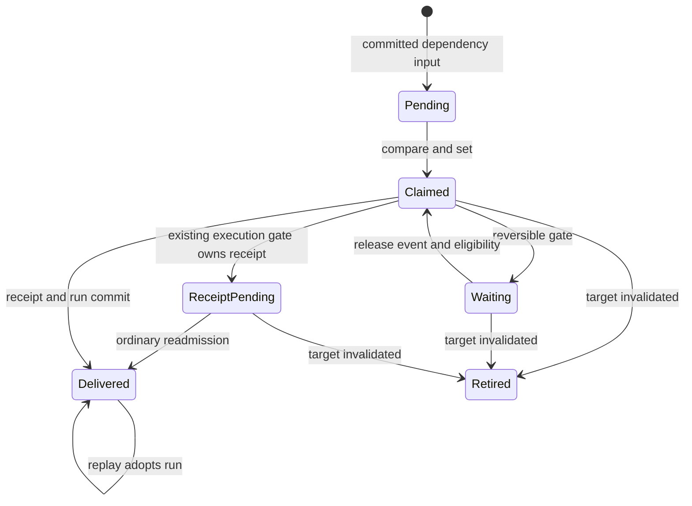

# Dependency wake retention during pause and budget holds

Date: 2026-10-28. Design for [#130](https://github.com/phenix3443/paperclip/issues/130).
Status: proposed; requires independent approval of the exact PR head before implementation.
Source baseline: `99481ae2e0f5869d85c95a8cb3961930dc23b489` on `origin/develop`.
Documentation draft [#132](https://github.com/phenix3443/paperclip/pull/132) was opened before this file was created.

Upstream adaptation is tracked in [#149](https://github.com/phenix3443/paperclip/issues/149).
The approval of #132 does not approve that adaptation. The worker and topic named
below are fork-specific. Keep implementation #131 and draft #138 paused until
the supplemental design has passed exact-head independent review and merged.

## Problem and acceptance contract

A dependency can finish while its dependent's agent is manually paused or budget-blocked. The completion must remain durable without starting work. After an authorized resume or a real budget release, the existing delivery worker must admit one wake automatically. A saved queue row alone does not establish delivery: acceptance requires a linked heartbeat run and one adapter invocation, with no second invocation after repeated events or restart.

The evidence reported in #130 at `8c6e35915b43b51076114328ff7db6f821aa0a30` is historical, not a new test result from this document: pause produced zero runs and one skipped receipt; idle plus two dispatches still produced zero runs. Its budget case only simulated agent state. Implementation must reproduce both failures through the real database, dispatcher and budget policy before fixing them.

This task changes documentation only. The behavior repair belongs to [#131](https://github.com/phenix3443/paperclip/issues/131), after this design is approved and merged. Do not change the blocked-cycle key repair in #111/#126, the separate completion-readiness race, manual pause semantics, review decisions, checkout ownership or budget limits. No tables, migrations, routes, schedulers, host polling or experimental switches are proposed.

## Verified source facts

Paths below refer to the baseline, rather than to a promised implementation.

| Owner / source | Current behavior and implication |
| --- | --- |
| `server/src/services/native-runtime/status-decision-committer.ts`, `enqueueWake` and dependency effects | Persists a `native-status-committer` intent in the status transaction. Deduplication covers `queued`, `deferred_issue_execution`, `claimed`, `completed`. The baseline native emitter still uses the per-edge key; changing that key belongs to #111. |
| `server/src/services/heartbeat/queue.ts`, `dispatchPendingNativeStatusWakeups` | Scans queued/claimed intents without a run, claims them, and calls normal admission. `recoverFromDispatchReceipt` copies even a no-run skipped receipt onto the intent. This removes it from later scans. |
| Same module, `enqueueWakeup` | Budget refusal records `budget.blocked`; agent refusal records `agent.not_invokable`. These can be skipped diagnostic receipts. The latter also covers permanent invokability failures, so its name alone cannot establish transience. |
| Same module, `promoteDeferredDispatchReceipts` | Reuses trusted deferred receipts with `dispatchReceiptReadmissionId`. Preserves provenance and avoids dispatching both the original intent and its deferred receipt. Keep this property. |
| `server/src/services/execution-wait.ts` | Coalesces skipped diagnostics under the issue lock. Diagnostics explicitly are not authority to suppress future wakes. It does not supply a recoverable outbox by itself. |
| `server/src/services/cross-task-continuation.ts` | Validates native dispatch provenance and pages deferred receipts. Existing eligibility filtering covers execution/recovery blockers, but is insufficient to distinguish a paused or budget-held receipt from runnable work. |
| `server/src/services/cross-task-continuation-worker.ts` and `server/src/index.ts` | An existing coordinator registration invokes the shared dispatcher. Its pending-intent query only names the cross-task committer, not the native status committer. Merely retaining a native queued intent does not activate this worker. |
| `server/src/index.ts`, startup recovery and heartbeat scheduler; `server/src/services/heartbeat/recovery.ts`, `reapOrphanedRuns` | Startup orphan reaping and every unsuppressed, non-draining heartbeat scheduler tick call `reapOrphanedRuns`, which calls `dispatchPendingNativeStatusWakeups`; that dispatcher ends with `promoteDeferredDispatchReceipts`. Native intents and deferred receipts therefore already have a periodic driver independent of the delivery worker. |
| `server/src/services/agent-lifecycle-driver.ts`, `onReady` | Calls `resumeQueuedRunsForAgent`, which starts already admitted runs. It does not dispatch unadmitted dependency intents. |
| `server/src/services/budgets.ts` | Real admission reconciles company, agent and project policies. It accounts for observed exposure and outstanding accounting, and releases only budget-owned pauses. A release needs a delivery signal; setting agent status to idle is not a budget release. |
| `server/src/services/delivery-work-notifications.ts`, DB work signals, delivery coordinator | Existing transaction-aware signals and shared deadlines can activate delivery after outer commit. Notifications are process-local hints; startup must reconstruct durable work. |
| `packages/db/src/schema/agent_wakeup_requests.ts` | Has a primary key, JSON payload, claim timestamps and existing statuses. There is no native-status dispatch unique index equivalent to the cross-task dispatch index. Actor names or a process-local map cannot establish uniqueness. |

## Terms and module interface

An **intent** is the committed obligation to offer this dependency input to its eligible assignee. A **receipt** records what admission did with that input. A **hold** is a current, reversible admission refusal; it grants no authority to run. **Delivery** in this design means that the input reaches a real admitted run and its adapter turn. A run may subsequently fail; that failure does not authorize another dependency delivery.

The deep module is native dependency delivery within the existing heartbeat queue. Its interface remains the dispatcher and normal wake admission. Recovery producers publish a scoped invalidation through the existing delivery topic; they do not create runs, reinterpret budget policy or select a new assignee. Put receipt identity, outcome classification and pending-work predicates in cohesive queue-owned helpers. Keep lifecycle and budget policy in their current owners. `heartbeat.ts` and `index.ts` need only wiring.

Introduce a private typed admission outcome for this trusted path: `admitted(runId)`, `waiting(gate)`, `retired(reason)`, or `retryableFailure`. It may wrap the current nullable-run return internally; unrelated callers keep their contract. Do not infer the outcome from an exception message, a null result, `status=skipped`, or actor-prefix text alone. Validate the durable origin, company, issue, agent and receipt binding from the database. Do not expose this authority as an HTTP option or accept it from caller payload/context.

## Outcome classification

| Observation under current admission authority | Outcome | Required action |
| --- | --- | --- |
| Manual agent pause, including a pause retained alongside a budget hold | waiting: agent pause | Keep input; only authorized lifecycle resume can remove this hold. Never resume it from dependency or budget delivery. |
| Applicable company/agent/project hard stop; reservations, pending or unpriced accounting still block | waiting: budget | Keep input; let the real budget service decide release. A raised limit is not sufficient if another policy still blocks. |
| Company/project pause, subtree pause, unresolved blockers, occupied checkout/execution or recovery gate | waiting: existing gate | Preserve input and use the gate owner's release event. Do not manufacture approval, clear checkout or run through blockers. |
| Pending review or human assignment | waiting or retired according to existing review/assignment policy | A dependency wake cannot replace the current review participant. Revalidate under the existing review gate; only its legitimate transition can make execution eligible. |
| Wake-on-demand disabled, setup incomplete, repairable org/configuration failure | waiting: configuration | Remain quiet until the supported configuration/lifecycle repair event. No timer retry of a known closed gate. |
| Missing issue/agent, terminated agent, terminal/cancelled issue, invalid company binding, superseded assignee or dependency generation | retired | Close this delivery without a run. Never resurrect it on resume. |
| Responsible user changes | re-evaluate current authority | Discard cached resolution. Resolve current responsible user and permissions in ordinary admission; a revoked/missing principal cannot be substituted with Board authority. Hold while unresolved. |
| Database/network error or uncertain transaction result | retryableFailure | Retain durable identity. Re-read committed receipt/run state before a bounded coordinator retry. Never turn uncertainty into successful delivery. |
| Receipt already owns a run, including succeeded/failed/cancelled run | admitted history | Adopt the recorded result. Never create another run for this input. Explicit failed-run retry remains its separate governed flow. |

For dependency readiness, re-read current blocker relations and issue state at admission. A reopened blocker means waiting, not permanent loss. A different blocked cycle or changed assignee retires the old target input; the existing dependency producer is responsible for the current input. Coordinate this with #111's approved key contract without rewriting that patch here. Retirement is not proof that the new assignee was notified: tests must exercise the normal reassignment producer and prove current-owner delivery separately.

## Durable transitions and receipt idempotency

Use existing status values and versioned private payload metadata. No new database column is required. The proposed metadata records delivery state/gate, the reserved receipt UUID, and the observed target binding. It contains identifiers and gate codes, never credentials or a copied permission grant.

1. Under the company-scoped issue row lock, then the intent row lock, validate a native dependency intent and reserve one random receipt UUID in its payload before attempting admission. Every retry reads this same UUID. Match the producer's established accounting/company lock order whenever accounting locks are needed; do not call budget evaluation while holding locks in the reverse order.
2. First claim uses a compare-and-set from queued to claimed. Reclaim compares the exact observed `claimedAt`, for ordinary native intents too. Final updates compare the current claim token; an expired worker cannot overwrite a newer claim or terminal result.
3. A known hold leaves the original intent `deferred_issue_execution`, with a private `waiting` marker and no run. It remains the sole pending authority. This status already participates in producer deduplication. Do not make a dispatch receipt just to record each refusal; update the bounded gate metadata on the intent. Held originals must be recognized separately from trusted deferred dispatch receipts and excluded from generic run promotion. Register a transaction-aware invalidation before the first wait-marker write, so a release that committed just before parking cannot leave an eligible waiter unseen. Reobserving the identical closed gate performs no write or self-notification.
4. On a real gate-change event, re-evaluate waiting originals and existing deferred receipts. Claim only an eligible original. Pass the reserved UUID into normal queue admission through the private trusted interface. Re-read it under the admission issue lock before any run insertion. Insert/adopt the receipt and run in the same transaction. The primary key is the final cross-controller uniqueness fence: a conflicting insertion rolls back the losing run transaction and adopts the winner after commit. Never commit a run before its receipt fence.
5. If normal admission must defer behind active execution, use the same reserved receipt UUID, the existing trusted deferred-receipt shape and saved wake context. Point the original at that receipt and mark it coalesced. There is now exactly one promotion owner. The original must not be independently runnable. Producer deduplication for this path must follow the validated intent-to-receipt link, including this coalesced state, instead of emitting another copy.
6. Successful admission links both records to the same run. Later dispatcher/recovery calls adopt that linkage, even after the run terminates. A permanent refusal terminalizes the pending original/receipt under the same lock; no run is created. Keep enough reason metadata to inspect the decision.

`Waiting` maps to the original's deferred status with metadata. `ReceiptPending` maps to a coalesced original plus one trusted deferred receipt. `Delivered` is a run linkage, not a bare `queued` status. A crash between run/receipt commit and original-link update is recovered from the reserved receipt. A crash before admission leaves no run and one pending original. A fresh claim uses its actual expiry deadline; an unresolved database write retains the coordinator's settlement obligation.

Existing affected rows need a bounded compatibility path in the dispatcher/startup scan: recognize only native dependency origins and no-run receipts whose structured reason is an allowlisted reversible pause/budget refusal, validate both records and current target, then adopt that receipt UUID and park/re-admit through the same protocol. This handles an intent already copied to `skipped`. Do not delete history or reopen arbitrary skipped/failed/cancelled receipts, other native wake reasons, or any record that ever acquired a run. Ambiguous legacy data remains visible for explicit repair; do not guess from error text. One in-place adoption per legacy pair keeps receipt counts bounded. Multiple historical rows require deterministic adoption under the issue lock and retirement of surplus no-run copies before admission.

## Recovery triggers and quiet behavior

Extend the existing `crossTaskContinuations` delivery registration; do not register another scheduler. Keep the existing startup/reaper dispatcher call and scheduler cadence. Both that path and the delivery worker use the same queue-owned eligibility predicates before claim/admission and generic receipt promotion. A held original or held deferred receipt must be invisible to actionable candidate selection while its gate remains closed: no claim, admission, row update or receipt creation. Preserve the existing bounded per-tick reads; do not add a held-row scan, budget reconciliation pass or legacy sweep to each tick. Initial parking and bounded legacy adoption are settlement work, followed by the stable-hold contract. Reaper recovery after release remains available, but cannot substitute for the required release-event delivery proof.

The delivery worker's pending predicate must include native dependency originals, stale claims, legacy candidates and trusted deferred receipts. It must return runnable work, not merely the existence of held rows. Page with a stable `(requestedAt, id)` cursor; a page of held rows must not starve later eligible work. Separate a side-effect-free observational gate check from authoritative admission; the latter always rechecks policy. Reuse the budget owner's exposure/decision logic for that observation rather than maintaining a second budget calculation in the worker. Add waiting-gate eligibility filtering for existing deferred receipts too, or they will keep `hasPending` true during a pause.

| Real event | Existing owner to extend | Delivery effect |
| --- | --- | --- |
| Native dependency intent commits | Native status committer | Await `notifyDeliveryWork(tx, DELIVERY_QUEUES.crossTaskContinuations, taskHint)` (where `taskHint` is `task:<issueId>`) before the queue write in that transaction. The third argument is a free-form diagnostic hint, not a company filter; company/agent scope is enforced by durable queries and admission. Delivery starts after outer settlement, not at savepoint release. |
| Authorized agent resume becomes ready | Lifecycle transition/effects and `agent-lifecycle-driver.ts:onReady` | Invalidate the affected company/agent delivery scope after durable readiness. Retrying a ready callback is safe. Preserve normal lifecycle status and manual holds. |
| Budget limit raised, policy disabled or valid override | Budget transaction / `resumeScopeFromBudget` | Signal only after budget reconciliation has made a relevant eligibility change. Agent, project and company paths all need coverage. Recheck all applicable policies in admission. |
| UTC policy window rolls over | Existing budget enforcement worker and its window deadline | Reconcile through the budget owner, then signal delivery. Retained exposure and unsettled reservations can still block in the new window. No independent dependency timer. |
| Accounting settlement, correction or reservation release changes admission | Existing accounting transaction / budget enforcement notification | Reconcile applicable budgets and signal after outer commit. Do not equate financial row mutation with permission to run. |
| Existing checkout/recovery/subtree/dependency/review/configuration gate changes | Current gate owner's mutation or release callback | Invalidate the delivery scope through the same topic; do not consume pending input while another gate remains. Include agent reporting-chain repair and wake policy changes if classified as waiting. |
| Assignee/responsible user/terminal state changes | Existing issue mutation and native decision paths | Revalidate/retire old target input and process the current producer's input. No stale-authority run. |
| Process startup, coordinator resume or controller replacement | Existing worker lifecycle | Reconstruct pending work and claim/window deadlines from DB. Recovery must work without another dependency completion or manual dispatcher call. |

After initial parking/settlement, a persistent manual/budget hold with no scheduled release makes the delivery worker idle: it adds no recurring SQL/network scans or scheduled five-second retry. With the existing heartbeat scheduler running, quiet means zero row writes, new receipts, runs or adapter calls attributable to the held input, and reads no greater than the existing bounded per-tick dispatcher/promotion queries. This is not a claim that the whole server performs zero recurring SQL. Held input must not expand that read work or keep the delivery coordinator active. The existing worker's `retryMs=5000` is for failed eligible delivery, not a closed gate. A budget window is a real deadline owned by the budget worker. A stale claim or uncertain transaction is a concrete recovery obligation. Duplicate release events coalesce, and changes arriving during a scan/drain must retain another pass. Rollbacks must neither publish delivery nor lose a later committed event.

Process-local notifications do not cover arbitrary SQL writers or independent server replicas. Preserve the repository's existing supported writer/ownership contract: normal mutations use the same instrumented DB owner; controller startup/resume reconstructs state. Do not claim live cross-replica release from these signals. If deployment requires an unsupported independent writer to wake an already-idle controller, stop implementation handoff for that configuration and obtain an approved existing ingress/ownership solution; adding a listener or host poller is outside #130/#131.

## Races and invariant checks

- **Two dispatchers / stale claimant:** both use the stored receipt UUID, issue serialization and transaction fence. One run commits; the loser adopts it. A deterministic actor string alone is insufficient. Never rely on a process mutex for cross-instance correctness.
- **Release races a hold observation:** register notification intent before the gate write; retain an invalidation generation during scanning. A late waiter must be rechecked after the committed release, including when its wait marker was written after the first release scan.
- **Pause or budget reappears during admission:** normal accounting/lifecycle start authorization remains final. Recheck holds and current execution authority under their existing locking protocol before run/provider dispatch. A rejected admission keeps this input pending. If an admitted run is subsequently explicitly cancelled, preserve its receipt; do not silently run a replacement.
- **Restart at each persistence boundary:** reconstruct reservation, intent/receipt linkage, deferred ownership and stale claim deadline. Do not relaunch provider work that already ran. Preserve database transaction uncertainty and current cleanup ownership.
- **Owner or responsible user changes:** lock/re-read issue binding at admission; replace cached responsible-user resolution. Old actor/input cannot follow the task to another agent. Use the current assignment producer, not mutation of an old receipt's agent or principal.
- **Remaining blockers or pending review:** hold the input and preserve checkout/review invariants. Dependency completion does not approve a stage, advance a review round or clear an unrelated blocker.
- **Scope:** every lookup, claim, receipt adoption, legacy repair and run-link update includes company identity. A matching UUID/key in a foreign company is never admission authority.

## Regression matrix and evidence protocol

Use the assembled `heartbeatService` with a migrated embedded PostgreSQL database, real dispatcher, delivery coordinator and lifecycle/budget owners. Existing precedent: `server/src/__tests__/heartbeat-dependency-scheduling.test.ts`, `cross-task-continuation-worker.test.ts`, budget/accounting admission integration tests and lifecycle tests. Mock only the external adapter/provider and use its call count plus real run rows as the execution proof. A mocked budget result or direct status update cannot satisfy the budget case.

For each hold case, create a real dependent with a completed blocker and a native status intent through the existing producer. After initial parking/settlement, assert zero new runs, adapter calls, row writes and receipts, stable intent identity, and at most one dispatch receipt. Use deterministic coordinator/deadline control and bounded waits. Assembled-service tests do not start the `index.ts` scheduler: add separate scheduler/reaper coverage below. For release-event cases, explicitly disable the periodic scheduler/reaper driver, or freeze it before release and assert no tick occurred through delivery; keep the owning budget-window deadline enabled when it is the event under test. Release through the actual owning mutation/event, then make **no explicit dispatcher or reaper call**: await one adapter call and one linked run. Capture the release signal and coordinator activation to prove the event path. Only after that proof, repeat release and dispatch, finish the run, restart delivery, and assert counts remain one.

| Case | Setup / trigger | Required result |
| --- | --- | --- |
| Manual pause | Lifecycle pause before dependency completion; authorized lifecycle resume | Zero runs while held; no automatic resume; one automatic delivery after readiness. |
| Actual hard stop | Real positive billed-cents policy plus real observed spend, separately at agent, project and company scope | Budget admission refuses, appropriate hold persists, no provider work; limit raise/disable/valid override reconciles and delivers once. |
| Accounting exposure | Reservation, pending/unpriced cost and correction/settlement via real accounting paths | No delivery while policy still blocks; exactly one after exposure really permits it. |
| Window release | Cross actual UTC policy boundary using the existing budget worker deadline | Reconcile and deliver automatically; non-expiring unsettled exposure continues to hold. |
| Multiple simultaneous gates | Manual plus budget hold; two budget policies; company plus project hold | Partial release stays quiet and creates no run. Final legal release delivers once; manual hold always needs explicit resume. |
| Repeated signals | Duplicate completion/release, repeated dispatch before and after completion | Bounded rows and one run/call for the same logical input. No hot loop. |
| Concurrency | Two heartbeat instances and DB clients; simultaneous release/dispatch, stale claim takeover, pause/Stop race | Primary-key/transaction fence admits at most one run; no stale update reopens completed input; Stop remains authoritative. |
| Crash/restart | Before receipt reservation, after reservation/claim, after receipt+run commit before link, while held, while receipt deferred | Startup alone reconstructs work; eligible input delivers once; held input remains quiet; no repeated provider call. |
| Assignment | Agent A held, reassigned to B or human, then A resumes; repeat with responsible-user change/revocation | No stale A run or substituted principal. B receives current producer input once only when eligible; human/review gates remain. |
| Invalid target | Issue done/cancelled/deleted; agent terminated; invalid company binding | Retire without run; subsequent release/restart never resurrects it. |
| Dependency changes | Another blocker remains/reopens; changed blocker set/cycle | No early run. Correct current input delivers after legitimate dependency readiness; #111 key behavior is preserved. |
| Review / checkout | Pending stage, occupied execution, recovery/tree hold | No bypass. Existing release path promotes only the single valid delivery owner. |
| Tenant isolation | Foreign-company target, forged provenance, same-looking key | No foreign adoption, update, run or provider call. |
| Legacy receipts | Original already skipped plus reversible no-run receipt; permanent refusal; ambiguous data; historical run link | Only verified reversible pair is adopted in place; all other history stays closed or visibly unresolved. |
| Scheduler/reaper while held | Exercise the real `index.ts` scheduler callback or an assembled-app harness, including its `reapOrphanedRuns` call; drive multiple ticks under manual and actual budget holds. Cover held originals and held deferred receipts, plus startup reaping. | After initial parking/settlement, no admission, claim, row writes, new receipts, runs or adapter calls for held input. Count SQL reads against the baseline at equal ticks/page limits: no more than existing bounded per-tick reads, and no added hold retry/deadline. Other eligible work still progresses. |
| Release-event isolation | Freeze/disable periodic ticks for lifecycle resume, budget/accounting release and other gate-event cases; retain the budget owner deadline for window rollover. | No tick, explicit reaper or manual dispatch between release and delivery. A recorded release notification activates the delivery coordinator and yields one linked run/call. Missing event wiring must fail instead of passing on a later tick. |
| Worker lifecycle | Empty DB, completed history, only held rows, first producer, rollback/savepoint, write during drain, shutdown/resume | With periodic ticks disabled, no recurring delivery SQL/network after settlement; with ticks enabled, only existing bounded per-tick reads and no held-input writes. First committed event restarts work; rollback does not deliver; drain does not lose work. |
| Page fairness | More than one page of held records before one eligible record | Eligible input delivers; bounded pages progress without spinning forever over holds. |

Implementation evidence must include baseline/fixed full SHAs, exact commands and exit codes, real SQL snapshots of intents/receipts/runs, adapter invocation counts, event traces for legal release, and attributed query/write counts through a stable hold interval exceeding two old retry periods. Record scheduler enabled/disabled state, tick count and cadence, baseline/fixed reads at equal ticks/page limits, and before/after SQL snapshots (including claim and update timestamps) for both held originals and held receipts. Separate the tick-enabled no-write evidence from tick-disabled release-event evidence; an assembled-service test alone proves neither real scheduler wiring nor absence of masking ticks. First run the new regression against the baseline and retain the failing output, then the fix and retain passing output. A skipped embedded DB suite is missing evidence, not a pass. Existing failures remain reported even if a retry passes.

Run the smallest new assembled regression first with an overall command timeout. Then relevant dispatcher, budget/accounting, lifecycle and worker tests; before the implementation PR is ready, run required typecheck, `pnpm test:run` and build (use CI for long checks). Browser tests are unnecessary for this server-only repair unless its scope changes.

## Implementation and review handoff

Keep one repair slice with its integration tests: queue-owned classification/identity/retention, existing worker pending/deadline coverage, and the minimum producer/release wiring. Candidate files are `heartbeat/queue.ts` and cohesive queue-owned helpers, `cross-task-continuation.ts` / `cross-task-continuation-worker.ts`, the native status committer, lifecycle delivery effects/driver, and the existing budget/accounting release owners. Shared changes serve the single missing capability: signaling eligibility changes for retained native input. Existing cross-task, child-completion, review and non-native consumers must retain their behavior. If implementation requires broader policy changes, new persistence or more than one independent correctness guarantee, split/revise the plan for approval first.

The implementation in #131 must include the matching bug-fix PR to `paperclipai/paperclip` from upstream `master`, alongside the fork PR to `develop`. Follow upstream small-PR guidance: one fix with minimal files; if it exceeds about 300 lines or spans several modules, split independently reviewable repairs, or obtain the required upstream design discussion through CTO before submitting a larger PR. Keep tests with the behavior and revise this plan for approval if splitting changes its correctness contract.

This document makes design decisions; it does not claim a reproduced regression, green runtime suite or fixed delivery. Author self-review checks #130 coverage, source facts, module ownership, all state transitions and matrix completeness. Independent review must use the exact documentation PR head. Merge only that approved head after required checks pass, then verify #130 is closed. A new head requires renewed review. Approval or cancellation of this task is not implementation/deployment authorization; the dependent implementation stage opens only after approved plan delivery.
