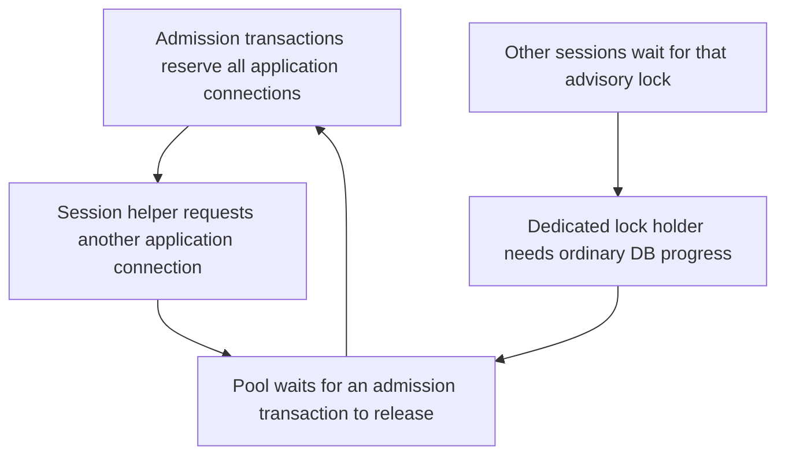

# Workspace finalization outage: pool starvation and minimal repair

Status: proposed design for [#104](https://github.com/phenix3443/paperclip/issues/104).
This document changes no runtime behavior. Implementation starts only after independent
review of the exact document commit, merge, and closure of that issue.

## Finding and evidence limits

The wake-admission path holds an application-pool transaction and then reads a task
session through the same pool outside that transaction. This is a source-proven
nested connection acquisition. With all pool connections reserved by that path,
each transaction can wait for a connection that only another waiting transaction
can release. Workspace finalizers that need ordinary database reads or writes then
stop progressing, even when their advisory lock uses a dedicated connection.

The private incident snapshot is consistent with this mechanism. It does not prove
which JavaScript continuation each backend was awaiting. No runtime reproduction
was executed for this design. Treat the specific incident attribution as a strong
candidate, and require a failing real-PostgreSQL regression before implementing
the repair. A matching source path alone is not proof of the entire incident.

The snapshot records ten `paperclip` sessions idle in transactions, with
`ClientRead`, no PostgreSQL blockers, and the same last statement:

```sql
select issue_id, execution_workspace_id, phase, status, started_at
from workspace_operations
where company_id = $1 and execution_workspace_id in ($2)
```

It also records four dedicated sessions: a granted advisory lock with two waiters
on the same key, and another granted lock on a different key. The latter uses a
combined lock/settings query. The ten application transactions start later than
the lock transactions; the snapshot does not establish the initiating event.
Opaque bind values, backend stacks, pool pending-queue state, and the effective
pool configuration were not captured. Ten observed connections do not by themselves
prove the configured maximum. No incident IDs, backend IDs, paths, or raw snapshot
are needed in the implementation or public report.

## Versions checked

References were fetched on 2026-10-28. Findings apply to these fixed revisions,
not to a moving branch name:

| Source | Full commit | Nested session read |
| --- | --- | --- |
| Affected fork | `fdbafff72d8fd6ae7f12eb5827631efc67d208f3` | Present |
| Fork `develop` | `73e13844502b00fbc9fc91503021b65227873be8` | Present |
| Upstream `master` | `d54f776ca0a00a9db457d6a6f14137414171e69c` | Present |

The affected and develop `heartbeat/run-state.ts` blobs are identical
(`e979572e222801434a7ec99bbba8bbdc9db22c02`). Other files have changed;
the relevant call sequence was checked separately in each revision.

## Source path and acquisition order

Use `git show <commit>:<path> | nl -ba` to inspect each reference. Line numbers
below refer to the affected revision unless another version is named.

1. `server/src/services/heartbeat.ts` constructs `createHeartbeatRunState(db)`
   and `createHeartbeatQueue(db, ...)`, injecting the real
   `hasResolvablePriorSessionWorkspaceForWake` function into the queue.
2. `heartbeat/queue.ts:2823` enters the issue-admission application transaction.
   At `:3761`, it calls `issuesSvc.listDependencyReadiness(..., tx)`.
3. `issues.ts` implements that read through `listIssueDependencyReadinessMap`
   and `listPendingFinalizeBlockerIssueIds`. The latter selects exactly the
   five fields in the snapshot. A done blocker with a workspace reaches it.
4. With isolated workspaces enabled, no active execution, a nonterminal issue,
   and no existing execution workspace, `queue.ts:3852` skips the workspace-row
   query. At `:3871` it awaits `resolveHasResolvablePriorSessionWorkspace()`.
   The closure at `:2575` invokes the injected run-state function without `tx`.
   Dependency readiness must permit this branch; unresolved finalize blockers
   otherwise return a persisted wait before it.
5. `heartbeat/run-state.ts:1432` first checks an explicit resume cwd, then the
   session-reset flag and task key. With no usable explicit cwd, no reset, and
   a task key, `:1450` calls `getTaskSession`. At `:1159`, that function selects
   `agent_task_sessions` using the factory's root `db`, not the admission `tx`.
   Its company, agent, adapter, and task-key filters remain necessary.

In develop the queue references are `:2862`, `:3827`, `:3936`, and `:2599`.
In upstream the dependency read and helper call are `:3691` and `:3800`;
the run-state helper and session call are `:1526` and `:1544`.
The helper also checks filesystem directory existence. That can delay admission,
but is distinct from the nested pool acquisition demonstrated here.



The minimal cycle is transaction -> root pool -> transaction release. A finalizer
and its advisory waiters can be downstream victims; the cycle does not require
an advisory lock. PostgreSQL sees clients waiting between statements and cannot
detect the JavaScript pool edge as a SQL lock deadlock. A `40P01` lock-deadlock
test would test a different failure.

## Locking and cleanup invariants

`packages/db/src/client.ts` already creates dedicated clients with
`maxConnections: 1` and the default application name
`paperclip-workspace-finalization-lock`. `withDedicatedDbConnection` closes them
in `finally` and retains the originating database's lifecycle guard. That name
is shared by several callers; it does not identify a lock namespace.

`execution-workspace-lifecycle-lock.ts` uses a blocking transaction advisory lock
keyed by `execution_workspace_lifecycle:<workspaceId>`. Native workspace ownership
uses `pg_try_advisory_xact_lock` keyed by company and run, plus a durable owner
receipt. `isolated-remote-workspace-source.ts` also uses a dedicated client and
a combined lock/settings query, with blocking and try-only modes. The snapshot's
combined **blocking** query must not be labeled as native try-lock ownership.
Without bind values the bare lock statement cannot be uniquely mapped either.

Preserve these contracts in the repair:

- Same-key lifecycle work remains mutually exclusive across processes. Different
  workspaces can progress independently. Preserve lock keys and acquisition order.
- Native try-lock contention returns busy without duplicate copyback. The durable
  owner fence and `assertHeld` checks continue to reject uncertain ownership.
- Database callback failure rolls back its transaction. Dedicated clients close
  on success, throw, and connection failure. Cleanup must join in-flight physical
  work before releasing its durable owner fence, as current native ownership does.
- Admission retains its issue-row locks, company scope, responsible-user checks,
  dependency/finalize barrier, pause/budget gates, and atomic wake/run persistence.
- A test deadline must cancel or terminate only its own test clients and join
  pending callbacks. Returning early through `Promise.race` alone is not cleanup.

## Smallest proposed change

The queue owns admission transactions. Run-state owns session lookup and decoding.
Keep that module interface; give the workspace-session check a transaction-bound
reader, and pass it through to `getTaskSession` rather than reopening the pool.

| Owner / file | Proposed change |
| --- | --- |
| `heartbeat/queue.ts` | Pass the current `tx` to the injected workspace-session check at its admission call. Keep the read at the present gate. |
| `heartbeat/run-state.ts` | Accept a narrow `Pick<Db, "select">` reader, defaulting to root `db` for callers outside a transaction; use it for the task-session query. |
| Queue dependency type / facade wiring | Update the typed contract in its owning queue module; the facade still injects the same run-state function. No new policy in `heartbeat.ts`. |

Do not cache a transaction-bound result across transaction attempts. Remove this
single-use closure cache, or scope it to the current transaction attempt. Calls
outside admission retain their default reader. Explicit cwd, reset, absent task
key, adapter codec, unsafe-cwd rejection, and directory-existence behavior stay
unchanged. A reader seam keeps connection ownership visible without exposing
credentials or making the queue interpret provider session payloads.

Do not increase pool size, remove the dependency barrier, release locks early,
replace cross-process locking with a process-local mutex, or move a policy check
outside its transaction to hide the wait. More connections merely move the
saturation threshold. A new dedicated pool for session lookup would add resource
ownership while leaving the existing transaction reader unused.

Nearby `issueService.update` workspace validation calls also default to root `db`
unless given a reader. They merit separate bounded follow-up, but their source
sequence is not evidence that those calls caused this snapshot. Do not expand
this repair into a general transaction rewrite without another demonstrated path.

## Regression design and acceptance

Use temporary PostgreSQL and real `createDb`/postgres.js clients. A mock that
returns readiness or the workspace-session result bypasses the connection edge.
Use the real run-state function injected into the real queue, then cover the
assembled `heartbeatService` wake entry point. Existing queue fixtures can supply
external adapter dependencies; do not start a real provider or remote service.

1. **Minimal red/green:** set application `maxConnections: 1`. Seed an eligible
   nonterminal dependent issue with no execution workspace or active run, a done
   blocker with a workspace and successful finalize row, isolated-workspace mode,
   a task key, no forced session reset, and no explicit usable resume cwd. Exercise
   normal wake admission. Gate immediately after its real dependency query so
   observations are deterministic. Before repair it cannot finish the nested
   session lookup while owning the only connection. After repair it records the
   expected wake/run or preflight disposition and commits within a fixed deadline.
2. **Saturation and progress:** repeat with pool size two and two distinct issues.
   Barrier both transactions after dependency reads, then release together. Require
   both to settle; verify persisted wake/run counts and issue execution ownership.
   A later ordinary `select 1` and an unrelated issue read/write must finish.
   A third query during deliberate full reservation may wait normally; only an
   indefinite wait after gates are released is a failure.
3. **Session semantics:** cover valid prior cwd, missing/unsafe cwd, explicit resume,
   reset, no task key, absent session, and another company's session. Confirm the
   disposition and workspace choice, including finalize-blocked admission. Test
   the existing nontransaction call interface as well as the new reader path.
4. **Finalizers under admission load:** while the admission barrier is held, start
   actual lifecycle-lock work that needs an ordinary progress write. Release the
   barrier and require that write and lock release to complete. Use two independent
   clients on the same key to assert no overlap; use another key to assert progress.
   Separately preserve native ownership's try-lock/busy and durable-fence tests.
5. **Errors and cleanup:** inject an error after session read and inside locked
   work. Assert admission rollback leaves no partial wake/run/checkout and locked
   work releases its advisory transaction. A new transaction, progress write,
   and same-key lock acquisition must succeed afterward. Exercise the existing
   connection-loss/physical-work-join test; no live database is a fault target.

The red control must use the unchanged affected call path, not a test-only
simulation of a semaphore. Record its deadline failure and backend state; then
run the identical assertions on the repair. Tests must restore any source mutation,
release all barriers in `finally`, terminate only isolated test clients on timeout,
and close temporary databases. Pin each outer test command with `timeout 600s`.

Implementation is accepted only with that red/green evidence, passing focused
queue/run-state and native-finalization suites, synchronized types, the repository
typecheck/test/build gates, and a separate Coder's exact-SHA review. Existing
`native-workspace-finalizer.test.ts` already tests one-connection ordinary progress
and lost-owner fencing; it does not exercise queue admission's nested session read.

## Upstream search and related work

On 2026-10-28, host `gh search issues` / `gh search prs` against
`paperclipai/paperclip` found no direct match using `"workspace" "pool"`,
`"connection pool" "workspace"`, or `"hasResolvablePriorSessionWorkspace"`.
The bounded searches used limits of 12–20 results. This is discovery evidence,
not an exhaustive claim that no duplicate exists.

- `"workspace" "finalization"` found related lifecycle reports, including
  [#17492](https://github.com/paperclipai/paperclip/issues/17492), a pending-selection
  problem. It does not establish the connection-acquisition cycle described here.
- `"workspace_operations"` found [#16417](https://github.com/paperclipai/paperclip/issues/16417)
  and [#14791](https://github.com/paperclipai/paperclip/issues/14791). Their bodies
  describe conflicting SQL row/FK locks, unlike the snapshot's unblocked idle clients.
- PR search `"pool" "deadlock"` found
  [#17454](https://github.com/paperclipai/paperclip/pull/17454). Its body describes a
  similar transaction-reader repair in tool-gateway admission. Reuse that principle,
  not its unrelated tool authorization changes. It does not repair this queue path.
- PR search `"workspace" "transaction"` found merged tracing
  [#16419](https://github.com/paperclipai/paperclip/pull/16419), not a pool repair.

The implementation needs a fork PR against `develop` and a separate minimal
upstream PR against `master`. This design PR alone makes no upstream fix claim.

## Risks, rollback, and remaining evidence

Passing the wrong reader, keeping a root-pool fallback in the transaction path,
or reusing a cached result after retry would retain the defect. Moving reads into
the transaction changes visibility to that transaction's snapshot; retain live
admission gates and test stale-session/reset behavior. Filesystem latency remains
an existing cost inside admission and is not solved by connection propagation.

The proposed repair needs no migration, public API, UI, or durable-state rewrite.
A code revert restores the old acquisition hazard; rollback is not a mitigation
for this outage. Never delete workspace owner receipts or relax recovery proof to
make progress. Health monitoring and socket-crash recovery are separate work.

Before coding, the reviewer must approve this exact design revision and its
qualified incident attribution. Before accepting a fix, replace the current
source-only evidence with the real-PostgreSQL red/green and cleanup results above.
