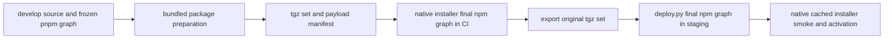

# Preserve the Postgres patch through distribution installation

Date: 2026-10-31. Design only. Requirement: [#302](https://github.com/phenix3443/paperclip/issues/302).
Implementation requires independent approval of the exact design SHA, merge into
`develop`, and explicit closure of #302. This document changes no runtime behavior.

## Problem and evidence limits

Paperclip declares a Postgres patch in its source workspace, but the inspected
incident installation contains the registry driver's unpatched files. An operator
needs the installed dependency to retain the reviewed behavior across packaging
and npm installation. A successful CLI version check does not establish this.

Reuse the incident report and [#106 / PR #107](https://github.com/phenix3443/paperclip/pull/107).
The report records source declarations, the installed four-file hashes and static
ESM resolution. PR #107 supplies the existing close/live fake-wire fixture and
its results. Neither proves the historical process's loaded bytes or the reason
its socket closed. Both remain **unknown**. This plan does not claim a crash fix,
transaction-safety proof or permission to repeat operational diagnosis.

Source identities inspected:

| Input | Fixed identity |
| --- | --- |
| Incident source | `fdbafff72d8fd6ae7f12eb5827631efc67d208f3` |
| Design source base / observed develop | `608c19fefe706efb61ea7769361104c955a3e51e` |
| Local upstream comparison | `91fdf02e956f80c29595c34c196735cf5ccc6dc8` (local ref, not a claim about latest upstream) |
| Prior reviewed investigation | PR #107 head `8f6f8874fe1ee462a033400892c64d16227fa262`, merge `06da98fba2a5c5805d9ff0d50ff665b3282e395a` |
| Incident patch SHA-256 | `ff4264722dcd40c9da222d7eae410139aee10aa549b1cf4685eeeaf7c21d7d18` |
| Design-base patch SHA-256 | `c9337ab6c34c3389ab1fc92f118acbc14bf692ffcf7996061967448891879bcc` |

The patches differ: the newer connection patch also changes the placement of
`onexecute` relative to the pipeline-length check. Generate separate expected
four-file hashes for each source. Do not compare current output against an old
patch hash or silently upgrade the driver during reproduction. Both source
manifests pin `pnpm@9.15.4`; both db manifests bundle only `embedded-postgres`
and declare `postgres: ^3.4.9`.

Upstream searches on 2026-10-31 found the already merged
[recovery patch #13643](https://github.com/paperclipai/paperclip/pull/13643) and
[older teardown revert #12234](https://github.com/paperclipai/paperclip/pull/12234).
The local upstream db manifest has the same Postgres bundling omission. These
are relevant prior work, not an equivalent installed-package preservation fix.
Search results do not prove no other fix exists. Recheck upstream before coding;
make a separate upstream contribution for an upstream packaging bug. Fork CI
changes stay fork-only. No maintainer contact is authorized by this design.

## First missing distribution contract

The original successful [deploy-packages run 40532366936](https://github.com/phenix3443/paperclip/actions/runs/40532366936)
remains available. Read-only download and archive inspection on 2026-10-31 found:

- Artifact ID `12748430303`, name `paperclip-payload-fdbafff72d8fd6ae7f12eb5827631efc67d208f3`.
- ZIP SHA-256 `1c5b3886ab630295fc53a8043edf334b9d88b07b409cbb9c023e6fc04fd17c90`,
  equal to the GitHub artifact digest; size 62,831,626 bytes.
- Manifest schema 1, repository `phenix3443/paperclip`, exact incident SHA,
  version `0.3.1`; all 18 listed tarball SHA-256 values matched.
- `paperclipai-db-0.3.1.tgz` SHA-256
  `1b27a97bf96d6efdaa36c4e8e0a31def50eabbae83f80ac45b8d3bf61ac9b4ae`.
  Its manifest bundles only `embedded-postgres` and retains the ordinary registry
  dependency `postgres: ^3.4.9`. It contains no `node_modules/postgres` files.
- No tarball in that artifact carries `node_modules/postgres/` or the Postgres
  patch file. The db compiled client still imports `postgres` externally.

Thus the first **observed missing patch carrier** is the exported tarball set,
before host staging. The source mechanism explains the omission: the bundled
package preparation installs and patches only declared bundled dependencies;
Postgres is not selected. The source workspace's pnpm patch declaration is not
an npm consumer contract. A frozen pnpm workspace may be correct while the
subsequent npm graph is unpatched. Hash-valid archives can faithfully carry this
incorrect dependency contract.

This identifies a fork packaging/installer concern. It disproves a conclusion
that the loss occurs *only* during the host's second npm installation. It does
not recover the deleted intermediate workspace or final CI payload from the old
run. No new frozen-lock source rebuild or final npm installation ran in this
plan task. The stage-by-stage replay below must establish the first byte-level
transition and verify the proposed treatment before implementation acceptance.

## Distribution trace and measurement points

| Point | Existing owner and contract | Required evidence |
| --- | --- | --- |
| A | `package.json`, lockfile, `patches/postgres@3.4.9.patch` | exact source, lock and patch hashes; frozen install; resolved four-file hashes |
| B | `scripts/prepare-bundled-package.mjs` | staged manifest, selected patch version, four files before packing; fail on missing/version-mismatched patch |
| C | `cli/src/commands/install.ts`, `payload-packages.json` | inspect actual tar entries, manifests, repo/SHA/version and each archive hash |
| D | native `installGitPayload` final `npm install` | installed lock, all reachable Postgres copies, resolution paths, four-file contents/hashes and controls |
| E | `exportGitPayloadPackages`, `.github/workflows/deploy-packages.yml` | the exported files equal those tested; workflow/run/artifact identities and ZIP digest |
| F | ai-team `deploy.py` staging install | in disposable CI, use exactly the same tarball list and npm arguments; repeat final graph measurements |
| G | native cached payload reuse | fake/disposable managed home only; graph unchanged after smoke/reuse; bad graph cannot become the selected payload |

The order matters: CI's native installation happens *before* tarball export;
the host installs those tarballs again. Manifest verification and CLI `--version`
currently check identity/version, not Postgres content. `deploy.py` adds its own
approval/receipt checks. Read its code and `docs/paperclip/patched-release.md`
only for ownership; do not invoke it, even with `--check`, in this task.

## Smallest proposed implementation

Use the existing bundled-package module and patch selector. Do not add a runtime
exception handler, dependency hot patch, database migration or general patch
framework. The interface under test is a packed package installed by npm.

1. Include `postgres` in the db package's bundled dependency declaration. Pin
   the producer's installed Postgres to the version selected by the declared
   source patch, reject drift, and apply the existing four-file patch before
   packing. Preserve the published consumer range only if the final graph tests
   prove it cannot replace the bundled driver with a registry copy.
2. Cover the CLI too. Its esbuild bundle includes db callers but leaves Postgres
   external; adding a db bundle alone can leave those callers on a second,
   unpatched root copy. Have the generated CLI publish manifest explicitly bundle
   the same patched Postgres version and stage that CLI package with the existing
   package preparation before `npm pack`. Keep Postgres external to esbuild so
   normal ESM/CJS exports and the four inspectable driver files remain available.
   Do not copy a pnpm symlink or rely on npm hoisting to make this work.
3. Gate native fresh install **and cached reuse** on the actual caller-resolved
   driver graph before promoting/selecting a payload. Prefer one narrow verifier
   owned by the install/package code, reused by fork CI. It receives a candidate
   payload and the expected patch identity; it reports paths/hashes or throws.
   Generate expected hashes from the independent patched reference during CI
   and ship them with the verifier in the CLI package; never derive the expected
   hashes from candidate payload bytes or require a source checkout at reuse.
   It must verify full expected content, not a version string or marker count.
   No new product routes, tables, scheduler or recovery mechanism is needed.
4. Extend fork package CI to test its exported tarballs in a second empty prefix,
   matching the host staging npm command. Publish the evidence only after this
   succeeds. A CI artifact may be uploaded for diagnosis on failure, but must
   never qualify as a successful deployable run.

Expected implementation files: `packages/db/package.json`,
`scripts/generate-npm-package-json.mjs`, `scripts/prepare-bundled-package.mjs`
(only if exact version selection needs adjustment), `cli/src/commands/install.ts`,
its install tests, `scripts/acpx-patch-packaging.test.mjs` or a focused Postgres
packaging sibling, and `.github/workflows/deploy-packages.yml`. A small verifier
may live beside the installer; its compiled/shipped availability must be tested.
Do not change the driver patch itself in this slice. Do not hand-edit the
lockfile; follow the repository's CI-owned lockfile workflow if a pin requires it.

If measurement instead shows correct tarballs and correct native installation
but a loss unique to host staging, stop this fork slice and return the exact
passing/failing artifact evidence to the parent for an ai-team Issue/workspace.
Any new host verifier or `deploy.py` edit requires that separately scoped work.

## Reproducible verification contract

Run full builds and packing in GitHub CI. Never run whole-repo compilation on the
service host. Record `node --version`, `npm --version`, `corepack pnpm --version`,
OS/architecture, source/lock/patch hashes, command arguments, stdout/stderr, exit
codes and timeout results for every replay. Do not log credentials or SQL data.

The original CI log records Node **24.21.0**, npm **11.19.0**; source declares
pnpm **9.15.4**. The incident runtime was Node **24.22.1**. The historical host
npm version was not recovered. Do not invent it. Use pinned Node 24.21.0 / npm
11.19.0 / pnpm 9.15.4 for the packaging replay, then run final-install controls
on pinned Node 24.22.1 with npm 11.19.0. Record that the second npm selection is
an experimental pin, not historical evidence. A supported current toolchain run
is additional evidence, with exact versions recorded separately.

Run untreated source and proposed treatment in separate clean CI jobs/containers,
each with a new HOME, pnpm store, npm cache, prefix and managed install root.
Do not inherit host `NODE_PATH`, production DB URLs or existing payload caches.
Build with `corepack pnpm install --frozen-lockfile`; fail on lock drift rather
than retrying with an unfrozen graph. Replay both the incident and design-base
source revisions. Run the treatment twice from independent empty environments.

At A, B, C, D, F and G, inventory **every** relevant Postgres package, including
nested copies, and record these relative files:

- `src/connection.js`
- `src/index.js`
- `cjs/src/connection.js`
- `cjs/src/index.js`

For each source version, obtain the registry base tarball and verify its integrity;
apply that source's exact patch in a separate reference directory. Expected
four-file hashes come from this reference, never from the candidate under test.
Verify all patch hunks and complete file hashes. Include package manifests and
lockfile `resolved`/`integrity` values. Identical `3.4.9` version strings do not
prove identical bytes. Cloudflare output is outside this Node-only patch scope.

From probe files beside the installed CLI and db caller locations, record
`import.meta.resolve('postgres')` under Node's import conditions and
`createRequire(...).resolve('postgres')` under require/default conditions. Follow
the selected index's relative connection import/require. Assert real paths stay
inside the isolated payload and match the inventoried copies. Do not resolve
from the repository or an unrelated temporary probe directory. Every caller
must reach a patched copy; detect duplicate unpatched copies and fail.

Reuse the exact standalone fixture in PR #107 (including fixture SHA-256
`95954494ea5d673cf945fdc77e97ff1fb0ac965de7582b603ceeaf2fe91ac48c`
and bounded close/live commands). Run each case as an isolated child with
a 15-second hard deadline, for ESM and CJS at D and F and after G's cache reuse:

| Variant / mode | Expected result |
| --- | --- |
| Untreated registry driver, close | exit 1, original `Immediate.nextWrite` null-write signature; this failure validates the control |
| Patched final installed driver, close | exit 0, caught `CONNECTION_CLOSED`; no uncaught exception or pending query |
| Registry and patched driver, live | exit 0, `OK`; healthy traffic must still work |
| Missing file, one reverted hunk, changed version, incorrect hash or escaped resolution | install verifier rejects before promotion; no backup, activation or restart request |
| Poisoned same-SHA cache | reject reuse; do not accept `--version` success or silently rebuild/replace it |

The old probe establishes a known lifecycle regression surface, not the production
close trigger. Reuse the existing real-PostgreSQL recovery suite in CI if the
implementation changes driver bytes, resolution or bundling. Preserve its
transaction/reconnect checks; no automatic replay of ambiguous writes. Report
all failures, including failed controls and timeouts, even after a later retry.

Acceptance evidence must include a stage table naming the first failing point
and its last passing predecessor. An omitted patch in a tarball is evidence of
a lost carrier; a four-file hash difference after npm is evidence of installed
byte loss. Label them separately. Two independent clean treatment installations
must select the same expected patched files and pass the same controls. Native
installer tests must prove failure leaves the selected payload unchanged. A
host-only failure requires the separate ai-team gate described above; CI mocks
cannot prove production pre-backup behavior.

## Delivery and rollback

The design PR records its base/head, all contributors, actual checks and remaining
unknowns. A different-type Coder who did not author it reviews that exact head.
After applicable CI passes, the reviewer merges the approved document into
`develop`, records the merge SHA and explicitly closes #302. Approval of this
plan does not authorize code changes in this task or deployment in another task.

The later implementation PR records red/green distribution evidence and receives
its own exact-SHA review. A separate release decision must bind the approved
source, workflow/run/artifact tuple, package hashes and known rollback payload.
No source-tip substitution is permitted. Packaging verification must fail in CI
before any production backup/switch/restart. If a deployment integration guard
is needed to enforce this for arbitrary caches, obtain the ai-team scope first.

Revert the packaging change through a reviewed source PR if candidate verification
fails. Reject the candidate and retain the existing selected payload. A later
production rollback belongs to ops under the existing managed release procedure;
it is not run here and can restore the old missing-patch defect. Do not delete
receipts, retained payloads or diagnostic evidence. Rollback changes no database
schema and does not replay transactions or restore a database.

## Checks performed for this design

Performed: source/patch comparison, prior investigation and incident report read,
upstream search, original CI log read, authenticated artifact download, ZIP digest
and all 18 tarball hash checks, and tar member/manifest inspection. The original
artifact already lacks a Postgres carrier; no production path was touched.

Not performed: new frozen-lock installation, full source build, new final npm
installation, new close/live controls, real-SQL suite or production acceptance.
Those are required later evidence, not passing results of this documentation PR.
The PR supplies documentation checks and exact-head CI status separately.
