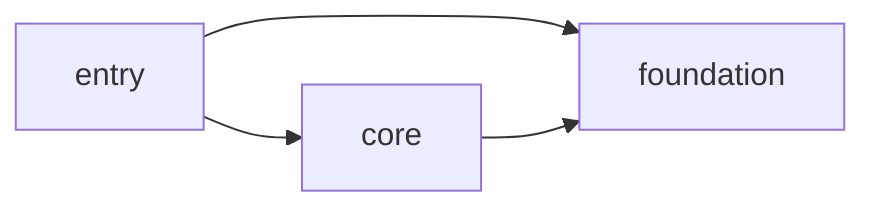

# Server import 循环与编译切分方案

建议 **no-go 现在实施大规模 import 改造**。图证据支持先评估不改源码的 SCC 闭包分组；只有另行授权后，才做一次配置候选的 CI 验证。本方案不授予实现、文件移动、运行时改造或额外测量权限。[需求 #184](https://github.com/phenix3443/paperclip/issues/184) 在文档合并后仍保持 OPEN，等待是否实施的决定。

## 版本、证据与复现

| 项目 | 固定版本/出处 |
|---|---|
| 源码基线 | `4c4a4be3a6639c6f5b7f268823b368180b985f9f`，取证开始时 fork develop 顶端 |
| 前置 | #181 merge `63ec4fa0f31f911d55159e0fa32a58b82804c6f5`，已核对为源码基线祖先 |
| 采集器/workflow | `332f426979ca4a2e3e96d9731153b013444ac33e`，一次性 `chore/server-import-graph-evidence`；不合入 develop |
| CI | [run 41388046707](https://github.com/phenix3443/paperclip/actions/runs/41388046707)，job graph 成功，2026-11-02 04:25:05 UTC 完成 |
| 可下载原始 artifact | [server-import-graph-evidence](https://github.com/phenix3443/paperclip/actions/runs/41388046707/artifacts/13115972439)，ID `13115972439`，digest `sha256:c68944a02168f809a22c494ab631f495ff3e6e43a1e69b6b11051b45be12b0e9` |
| 保存期 | GitHub artifact 到期日 2027-01-31；原始文件、完整采集器/workflow、工具锁文件、上游统计及派生分析另作为本方案交付任务的下载附件归档，不只依赖临时工作区或到期 artifact |
| 分析环境 | Node `v24.22.1`、pnpm `9.15.4`、TypeScript Compiler API `5.9.3`；项目 compiler 依赖 `^7.0.2`，与旧内存 run 的 `7.0.2` 分别记录 |

workflow 分别 checkout 诊断 head 与固定源码，`pnpm install --frozen-lockfile --ignore-scripts` 后向 runner 临时目录安装 `typescript@5.9.3`。执行：

```sh
GRAPH_TYPESCRIPT="$RUNNER_TEMP/graph-tools/node_modules/typescript/lib/typescript.js" \
GRAPH_OUT="$GITHUB_WORKSPACE/evidence" \
node "$GITHUB_WORKSPACE/diagnostic/.github/scripts/server-import-graph.mjs"
git diff --exit-code
```

脚本读取 `server/tsconfig.src.json` 及其继承配置，使用 Compiler API 创建 program、解析模块和查询符号；不调用 emit、diagnostics 或 typecheck。CI 保存 `metadata.json`、`edges.json`、`unresolved.json`、`graphs.json`、`files.json`、`summary.json`、完整脚本/workflow及 SHA256、工具/source 锁文件和三份 tsconfig。当前提交仅文档，无源码、tsconfig、包脚本或 workflow 改动，无拆分原型或新增内存测量，不含 #183 缓存实现。

[数据附表](2026-11-02-server-import-cycle-evidence.md) 列出两种分组的**完整跨组边数**及符号分类。下载包中的 `candidate-partitions.json` 给出三个候选 project 的逐文件完整名单；`summarize-graph.py` 只遍历 CI JSON，复算互斥分配、计数及 DAG，不重新解析/编译源码。

## 实际图：目录成环与文件成环是两件事

扫描 1,678 个 server 源文件，627,652 行；行数为 `text.split(newline).length`，包括空白、注释和末尾空行，不是净代码 LOC。排除测试的配置仍可能通过 import 拉入 fixture/声明文件，采集器按 program 实际纳入文件统计。

共 13,664 条可记录字面量模块引用：13,227 import、281 export-from、89 dynamic import、60 import type query、7 require。其中内部边 8,852 条：显式纯 type-only 1,182、mixed 676、value/effect 6,994。混合边保留在两张图；重导出保留为依赖，star/namespace 不猜为函数或常量。绑定分类与 typeOnly 语法标记正交；bare side-effect import 为 0，不代表被导入模块没有副作用。

| 图 | 内部边 | 非平凡文件 SCC 大小 | 最大 SCC 行数 | 其内部依赖闭包 |
|---|---:|---|---:|---|
| type（保留所有显式类型边） | 8,852 | 540、4、3、2、2、2 | 320,009 | 1,293 文件 / 489,710 行 |
| runtimeConservative | 7,670 | 333、3、2 | 248,042 | 1,040 文件 / 407,726 行 |

runtimeConservative 仅去掉显式 type-only 和声明文件运行时边，是模块引用保守图，**不是 emitted JS 或实际执行图**。值语法但仅用于类型推导的 import 仍保留；dynamic import 为有条件加载，不代表启动时执行。type graph 内全部成环边记录 2,520 条，runtime 图 1,340 条，均在 `graphs.json.cycleEdges`；这些是 SCC 内边集合，不是已证明最小的反馈边集。

| 分组规则 | type 跨组边/唯一方向对 | runtime 跨组边/唯一方向对 | 最大组 SCC |
|---|---|---|---|
| top：src 第一层目录，直属文件为 src-root | 2,403 / 64 | 2,239 / 59 | 两张图均 12/15 组 |
| serviceSubdirs：额外拆出 services 的直属子目录 | 4,568 / 167 | 4,109 / 158 | 两张图均 22/29 组 |

第二种规则的主组 SCC：adapters、auth、http、lib、middleware、modules、realtime、routes、secrets、services、services/chat-channels、services/connectors、services/grok-bot、services/heartbeat、services/native-runtime、services/photon、services/public-mcp、services/recovery、services/tool-access、services/voice、src-root、storage。其余 7 组见附表与原始图。type 最多的跨组方向是 routes→services 483、chat-channels→services 437、heartbeat→services 413、native-runtime→services 410。

按目录合并会把本不互相可达的不同文件折叠到同一节点，所以 22 个目录成环不等于这些目录的所有文件都在一个文件 SCC。反例：`chat-channels.ts` 在 type 主 SCC 内，在 runtime 图中却是 singleton；不能把它写成 333 文件 runtime SCC 的成员。

### 未解析项逐类交代

原始 `unresolved.json` 保留 **445 条**，人工复核结果另存归档，不改写 CI 原始记录：

| 类别 | 数量 | 影响与处理 |
|---|---:|---|
| module-resolution-failed | 58 | 全为外包；无相对路径解析失败。plugin-sdk 41，paperclip-runner 主入口7、testing2、live1，@sentry/node1，OpenTelemetry六包各1（含semantic-conventions）。ignore-scripts 未生成部分声明/可选包缺失；这些不是已经证明无依赖 |
| symbol-classification-unknown | 338 | 128 个在内部边上，沿 vendor/paperclip-runner 重导出终止于缺失外包声明；另210为外部符号。内部 source→target 边仍存在，不能把未知 kind 猜成常量或函数 |
| nonliteral-module-reference | 49 | 42 为 `native-runtime/remote-pi-companion.ts:17` 的本地 `function require(...): asserts value` 调用假阳性，人工核验不是真实 loader；其余7为真正动态引用 |

58 外包引用的精确包名/每条位置以清单为准；上述 OpenTelemetry项总计6条。7 个真实非字面量 loader 位于 vendor/paperclip-runner/index.ts:88、live/index.ts:7、testing.ts:27、adapters/plugin-loader.ts:200/259、services/plugin-loader.ts:1377、index.ts:530。它们涉及 vendor 源码加载、插件 URL 和可选 instrumentation。未穷举其未来/配置目标，**不能证明完整运行时加载 DAG**。aliased/computed loaders 超出显式 import/require 语法扫描范围。

5.9.3 API 解析 7.0 项目配置也不是 7.0 compiler 对图或声明正确性的认证；本次不运行 diagnostics，未证明不存在新语法解析差异。所有候选仅针对已解析字面量文件图。现有实在回路足以否定直接按目录拆 project；未来若要实施候选，必须先解析动态目标、核验 ambient/module augmentation 和声明输出，不能把缺失边视为无边。

## 哪些边真实成环

所有位置相对 `server/src/`，以固定源码 SHA 为准。

| 回路 | 具体边与符号 | 判断 |
|---|---|---|
| heartbeat ↔ queue | heartbeat.ts:79→heartbeat/queue.ts，函数 `createHeartbeatQueue` 等与常量 `DEFERRED_WAKE_CONTEXT_KEY`；:85 另有函数重导出。queue.ts:203→heartbeat.ts 的 `HeartbeatServiceOptions` 是 type-only，:230仅消费其一个回调 | 可以用窄 Options 合同移除该类型回引，不能把实际函数 import 改成 import type |
| heartbeat ↔ dot | heartbeat.ts:25 `dotRunnerBroker`→dot-runner-broker.ts:2 重导出→modules/external-agents/index.ts:4 重导出→dot.ts:38 dynamic import heartbeat | fallback 的 runtime 边；dot.ts:9 的类型边移除后仍存在 |
| heartbeat ↔ muse | 共用前述 broker/index 链，external-agents/index.ts:1 `museExternalAgents`→muse.ts:47 dynamic heartbeat | 只有未注入 heartbeat context 时走 fallback，但仍是静态文件依赖；强制注入或换缓存改变 runtime wiring |
| chat 混合回路 | heartbeat.ts:30→heartbeat/execution-configuration.ts:21→connection-intents.ts:2→chat-channels/credentials.ts:16 的 type `CredentialMutationLeaseGuard`→chat-credential-mutation-lease.ts:6 的 type `ChatChannelServiceOptions`→chat-channels.ts:218 的 `issueService`→issues.ts:308 dynamic heartbeat | 中间两座纯类型桥梁解释 type/runtime 图差异；不能为拆分而迁移 credential lease 或 issue post-commit 生命周期 |

对原始 JSON 做删除敏感性分析（不修改源码、不代表可实施补丁）：只删 queue.ts:203 的一条类型边，主 type SCC 仍 **540**；理想化删掉全部 12 条指向 heartbeat facade 且 runtime=false 的边，也只降到 **539**。所以“抽少量这些合同就能拆开主核心”的假设不成立；本方案不声称找到了可低成本解除全图的几条最小边。

## 三种切法与另一种分组

### A：按文件 SCC 闭包分组，优先保留源码位置

设 core 为 540 文件主 type SCC；foundation 为 core 能到达的所有非 core 内部依赖；entry 为其余文件。遍历已解析图得到：

| 候选 project | 文件/源行 | 跨 project 依赖记录 |
|---|---|---|
| foundation | 753 / 169,701 | 没有指向 core/entry 的已解析边 |
| core | 540 / 320,009 | →foundation 3,074 |
| entry | 385 / 137,942 | →core 596，→foundation 908 |



这是归组后的观测 DAG，不是编译通过的证据。相对于按目录的22组大环，它揭示“不能按现有目录拆”不等于“所有源码都必须先改 import”。但 declaration 输入仍可能很大：core 的源码闭包达489,710行，不能按 core 自身51%源行宣称内存减半。

受影响文件：新建 `server/tsconfig.foundation.json`、`server/tsconfig.core.json`、`server/tsconfig.entry.json`；修改 `server/tsconfig.src.json` 为 solution 引用入口、`server/tsconfig.tests.json` 指向相应项目（保证 src/types/ambient声明），`server/package.json` 的 typecheck顺序仅在现有 `-b tsconfig.src.json` 不能直接承接时调整；CI配套仅改现有 `.github/workflows/server-typecheck-memory.yml` 的项目变体。源码0行、无文件移动、运行时 imports 原样保留。

估算配置/脚本逻辑80–160行；若逐文件显式清单，另约1,678–1,750行数据，总diff约1,800–1,950行，不能沿用“60行配置足够”的早期估计。可压缩成无重叠glob，但需证明新增文件不会漏配。完整候选分配只在证据包中，当前不新增可执行配置或生成器。

拟保留共同 `rootDir=src`、现有 declaration-only 输出的相对路径；可评估公共输出根并保证文件所有权互斥、每项目独立 tsBuildInfoFile，或独立输出根加完整声明解析验证。不能默认不同outDir仍能自动解析所有相对声明import，也不改运行时构建的dist布局。JSON资产和全局声明需显式纳入/消费，solution配置本身不重复纳入全部src。[TypeScript官方project references文档](https://www.typescriptlang.org/docs/handbook/project-references.html)说明引用项目使用声明输出，并要求 composite 输入清单完整；这些约束需由未来CI实证，当前未验证7.0具体输出布局。

风险：TS6307/TS6059、声明相对路径/ambient失效、源重定向造成重复检查、动态引用漏边、新增文件漏配、多项目清缓存覆盖/残留、额外checker启动与声明解析成本。不同project并行会叠加RSS，第一步必须串行，不能靠并行掩盖单项目峰值。

### B：抽窄类型合同，保留原入口兼容

最小片为 `services/heartbeat.ts:752–787`、`services/heartbeat/queue.ts:203/230`、新增 `services/heartbeat/contracts.ts`：迁移约40行Options声明，原facade用type re-export保持兼容，queue从合同取所需回调，估算60–100行diff。它是 Interface 的收窄，不把整个 service context 或 `ReturnType<typeof heartbeatService>` 搬进合同；不转移状态、权限、日志或事务的 Implementation。

若再做 wakeup consumer 合同，涉及 `connection-tool-refresh.ts:5–20`、`case-handoff-delivery.ts:8–14`、`routes/connection-intents.ts:18/44/143` 和 `heartbeat/run-preparation.ts:830` 的 WakeupOptions 闭包，另约100–250行diff，需先明确所有消费者；这仍不是主SCC的切断集合。chat 选项仅作为上述回路解释，不在此片扩展实施。

范围是 type-level，保留现有文件与runtime入口；理想JS输出不变，但尚未实证。图删除试验明确它不够产生显著分裂，作为本次节省编译内存的方案 **no-go**。若为维护性另行立项，必须重新取得真实新图、检查声明兼容和JS等价。用 injected callbacks 替换 dot/muse fallback 属另一种依赖倒置，涉及至少heartbeat、dot、muse、broker/index及其测试，不能给出“类型改动”的成本或收益承诺，本任务排除它。

### C：只抽已存在的四个叶子

`errors.ts`、`db-errors.ts`、`database-retry.ts`、`services/native-runtime/canonical.ts` 均为无内部出边的singleton，合计 collector口径179行（`wc -l`175行）。新增 `server/tsconfig.foundation.json`，调整src/tests引用，约40–90配置行，源码0行。所有import和timer等运行逻辑保留。占总源行0.029%，主540 SCC不变，固定compiler成本可超过收益；仅为内存收益不值得实施，推荐 **no-go**。

## 上游维护成本：固定90天窗口

固定 `upstream/master` SHA：`1a6017d6460267ad89d7e1784e2b521c28d8e9ac`。窗口：`(2026-08-03T10:08:51-06:00, 2026-11-01T10:08:51-06:00]`；结束为该提交 committer 时间，起始减去 90 天。

方法：沿固定 SHA 的可达历史，`--no-merges` 排除合并提交（保留可达的普通被合并提交）；按 committer 时间筛选，解析后再严格执行半开窗口。改动日数使用 UTC 日期；`--no-renames` 不追踪历史旧路径。增删行是 numstat 累计，不能当作当前净 diff。

命令：
```sh
git log 1a6017d6460267ad89d7e1784e2b521c28d8e9ac --no-merges --no-renames --since=2026-08-03T10:08:51-06:00 --until=2026-11-01T10:08:51-06:00 --format=@@%H|%cI --numstat -- server/tsconfig.json server/tsconfig.src.json server/tsconfig.tests.json server/tsconfig.build.json server/package.json .github/workflows/server-typecheck-memory.yml .github/scripts/server-typecheck-measure.sh server/src/services/heartbeat.ts server/src/services/heartbeat/queue.ts server/src/services/heartbeat/contracts.ts server/src/services/heartbeat/run-preparation.ts server/src/services/connection-tool-refresh.ts server/src/services/case-handoff-delivery.ts server/src/routes/connection-intents.ts server/src/modules/external-agents/dot.ts server/src/modules/external-agents/muse.ts server/src/services/chat-channels/runtime-types.ts server/src/services/chat-sdk-runtime.ts server/src/services/voice/voice-runtime.ts server/src/errors.ts server/src/db-errors.ts server/src/database-retry.ts server/src/services/native-runtime/canonical.ts
```

| 文件 | 触及提交数 | UTC 改动日数 | 增行 | 删行 | 上游 tip 存在 |
| --- | ---: | ---: | ---: | ---: | --- |
| `server/tsconfig.json` | 0 | 0 | 0 | 0 | 是 |
| `server/tsconfig.src.json` | 0 | 0 | 0 | 0 | 否 |
| `server/tsconfig.tests.json` | 0 | 0 | 0 | 0 | 否 |
| `server/tsconfig.build.json` | 0 | 0 | 0 | 0 | 否 |
| `server/package.json` | 66 | 29 | 157 | 57 | 是 |
| `.github/workflows/server-typecheck-memory.yml` | 0 | 0 | 0 | 0 | 否 |
| `.github/scripts/server-typecheck-measure.sh` | 0 | 0 | 0 | 0 | 否 |
| `server/src/services/heartbeat.ts` | 302 | 77 | 32592 | 47038 | 是 |
| `server/src/services/heartbeat/queue.ts` | 47 | 17 | 5424 | 306 | 是 |
| `server/src/services/heartbeat/contracts.ts` | 0 | 0 | 0 | 0 | 否 |
| `server/src/services/heartbeat/run-preparation.ts` | 19 | 11 | 3416 | 127 | 是 |
| `server/src/services/connection-tool-refresh.ts` | 0 | 0 | 0 | 0 | 否 |
| `server/src/services/case-handoff-delivery.ts` | 1 | 1 | 171 | 0 | 是 |
| `server/src/routes/connection-intents.ts` | 7 | 7 | 333 | 88 | 是 |
| `server/src/modules/external-agents/dot.ts` | 2 | 2 | 641 | 0 | 是 |
| `server/src/modules/external-agents/muse.ts` | 5 | 4 | 629 | 14 | 是 |
| `server/src/services/chat-channels/runtime-types.ts` | 4 | 2 | 94 | 1 | 是 |
| `server/src/services/chat-sdk-runtime.ts` | 5 | 5 | 3318 | 10 | 是 |
| `server/src/services/voice/voice-runtime.ts` | 1 | 1 | 49 | 0 | 是 |
| `server/src/errors.ts` | 2 | 2 | 10 | 2 | 是 |
| `server/src/db-errors.ts` | 2 | 2 | 52 | 0 | 是 |
| `server/src/database-retry.ts` | 2 | 2 | 51 | 2 | 是 |
| `server/src/services/native-runtime/canonical.ts` | 1 | 1 | 18 | 0 | 是 |

注意：新增 `heartbeat/contracts.ts` 没有历史，不是零维护成本。上游 tip 不存在的 fork 配置/workflow 即使统计为 0，也不能解释为将来不会冲突。这里只统计固定路径，不跟随重命名；文件创建前的旧路径变化不计。

这些是改动频率和累计行数的代理指标，不是冲突概率实测。未模拟 develop 每日 merge，也没测 conflict hunks。合同抽取若改动高频 facade/queue，会使后续相同行周围的变更更容易需要人工协调；纯新增编译配置可能免于内容冲突，但仍可能因上游新增源文件或 compiler 配置语义变化而失效。

原始完整记录：`upstream-cost.json`（每文件逐提交 SHA、committerDate、增删行）与 `upstream-cost-git-log.txt`。统计过程未改源码。


只统计候选A/B/C真正可能修改的既有文件及解释回路的背景文件。A的完整 source分配是编译输入清单，不等于将修改全部1,678源码文件，因此不把所有源码历史计作A的patch冲突面。新建配置/合同无历史，不能推成零维护；B触及heartbeat高频位置，90天302次提交/77个改动日，显著高于新增fork配置的直接冲突面。未模拟每日merge，未统计冲突hunks，不能给冲突百分比或每周工时承诺。

## 收益：已有实测与候选假设分开

[旧memory run 40847996009](https://github.com/phenix3443/paperclip/actions/runs/40847996009) 的源码为 `ba865fa6fdf928a8bb91c30a10f7113b7f348e02`，TypeScript7.0.2，十项RESULT exit均0；不等于当前源码或候选的收益。

| 旧变体 | peak RSS MiB | wall s |
|---|---:|---:|
| 原始mixed source/tests | 9593 | 30.70 |
| mixed checkers2 | 8213 | 30.26 |
| mixed checkers1 | 6343 | 39.49 |
| source-only noEmit checkers2 | 5036 | 19.80 |
| source declarations checkers2 | 6197 | 23.53 |
| tests warm checkers2 | 2722 | 8.37 |
| source declarations checkers1 | 5212 | 31.66 |
| tests warm checkers1 | 2260 | 10.43 |
| source unchanged | 50 | 0.11 |
| typecheck-script端到端 | 6048 | 44.12 |

**候选没有原型实测。** 为表达不确定性，A仅给敏感性场景，绝非置信区间或可靠上限。设 `M_i = B + (M0-B)*(f_i + rho*d_i) + H`：f为自身源行占比，d为其余内部依赖源行占比，rho为声明消费相对源处理权重，B为固定环境成本，H为新项目额外开销。假定B=1000–2000MiB、rho=0.1–1、H=0–500MiB，全部是未校准假设；M0分别取旧6197/5212。foundation的d=0，core的d=0.2704，entry的d=0.7802。外包声明复杂度/类型推导不是按行线性变化，真实值可以超出整个场景范围。

| A的project | 2-checker估算MiB | 1-checker估算MiB | 含义 |
|---|---:|---:|---|
| foundation | 2405–3635 | 2139–3368 | 额外一次checker固定启动成本 |
| core | 3790–5775 | 3261–5006 | 仍消费foundation声明；无法保证减半 |
| entry | 2548–6697 | 2254–5712 | 最坏消费全部source的声明，可比旧源项目更高 |
| tests | 仅沿用旧2722，敏感性±50%为1361–4083 | 旧2260，±50%为1130–3390 | 新声明解析/输出兼容未知，±50%也是假定 |

串行运行时取各项目峰值的max，不把RSS相加；以两checker场景约3790–6697MiB，较旧6197变化为降低2407MiB至**增加500MiB**，约节省39%至恶化8%。它只表明值得小范围验证与可能无收益，不能承诺通过某个宿主内存上限；一个 `tsc -b` 进程保留内存时其peak还可能高于分项目max。若并行，总常驻内存可趋向各RSS之和，因此不推荐并行。

B目前未产出可行分区，不能给“每项目”降幅，最小合同片仍是一个源项目，估算按旧6197/5212各±25%表达版本漂移，约4648–7746/3909–6515MiB，增量收益按0预算。若将来找到真正切断集合，再重新建模，不能把12边删除试验当收益实测。

C为叶子项目+原源项目+tests：叶子179行，仅自身场景约1001–2501MiB（含0–500MiB额外开销）；余下源项目仍约旧6197/5212各±25%（同B），tests沿用上述未校准范围。按源行比例的理想可变成本节省不足2MiB，远小于假设误差与额外固定成本，不能宣称净节省。

增量方面，现有不变源码已经是50MiB/0.11s。A只可能让部分改动局限在entry或core；foundation公共声明改变仍使下游失效，声明未变是否跳过需未来CI确认，未给确定时间收益。B修改Options可能传播到多个consumer；C四叶子少改但改公共错误声明时仍影响多数consumer。总体wall time可能因多次compiler启动而上升，不能把单项目变小等同总时间降低。

## 决定、最小第一步与停止条件

现在不做B的大规模类型抽取或runtime依赖倒置，不为C的极小体量增加项目。若决定进一步投入，最小下一步是**另行授权A的配置验证**：保持文件位置与所有runtime import不变，先对7个动态loader和缺失声明记录边界/目标，固定新源码SHA，确认互斥穷尽输入与声明输出路径，再仅在fork CI比较原配置与串行三项目。

未来验证应沿用server-typecheck-memory的方法记录exit、每project/端到端peak RSS与wall，对clean、unchanged、entry-only实现改动、foundation公共声明改动各采样；这不是本任务新增测量授权。对照类型检查、源/测试输入覆盖、公开声明解析与JS输出不变；测试所需的语义路径包括dot/muse无context fallback、chat credentials lease及issue post-commit，不能靠图计数替代行为检查。

停止条件：出现任何runtime wiring/输出差异、需要移动/重命名源文件、动态加载/ambient图仍未知而必须假定无边、composite/声明输出不兼容、遗漏/重复源输入；或未来同SHA的CI重复结果不能稳定达到至少25% peak下降（这一阈值是投入取舍，非实测），或总wall恶化超过20%。超出这些边界先回到范围决定，不扩大patch或提高堆上限。

本方案不创建或开放实现任务。独立审核针对精确文档head；任何新head重新审核。文档合并并不关闭#184：须记录是否实施的决定，核对文档merge SHA与全部验收后再手动关闭需求。
